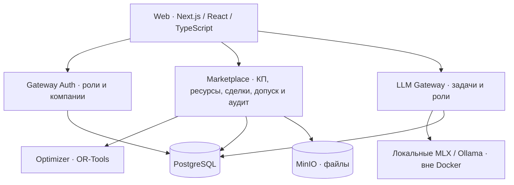

# ПоРукам — экосистема ИИ-агентов для российских B2B-закупок

ПоРукам — B2B-маркетплейс как среда координации ИИ-агентов. Они помогают
покупателю сформулировать потребность, подобрать поставщика и запросить КП,
а поставщику — подготовить предложение и пройти согласование до исполнения.
Модель разбирает смысл, код проверяет выполнимость, человек подтверждает обязательства.
Интерфейс на русском языке, компании российские, расчёты в рублях.

**Основной маршрут:** потребность → разбор и проверка требований → запрос/КП
поставщика → подтверждение условий сторонами → исполнение и результат.
Группы и резервы дополняют этот маршрут и демонстрируются после него.

[Среда агентов](#agent-environment) · [Сценарии](#agent-scenarios) ·
[Архитектура](#platform-architecture) · [Демонстрация](#walkthrough) ·
[Запуск](#local-start) · [Приёмка](#acceptance) · [Критерии конкурса](#contest-criteria)

<a id="business-needs"></a>
## Бизнес-потребности целевых пользователей

| Пользователь и проблема | Функция | Проверяемый результат |
|---|---|---|
| Покупатель: разрозненные требования и несопоставимые КП | разбор материалов, уточнения, подбор и полная смета | поля и источники проверены; неполное КП нельзя согласовать |
| Поставщик: повторный ввод и неподходящий спрос | каталог, ресурс, автозаполнение КП и переписка | продавец проверяет готовые условия, правит и отправляет; ресурс не обещается дважды |
| Проверяющий / администратор: неподтверждённые документы и действия | предметный допуск, роли, согласия и аудит | недопустимое обязательство блокируется с конкретной причиной |

Детали B01–B13: [потребности бизнеса](docs/research/business-needs.md).
Постоянный поставщик, почта и таблица остаются сопоставимыми альтернативами;
эффект платформы требует проверки на одинаковой задаче.

<a id="agent-environment"></a>
## Среда ИИ-агентов

### Концепция и карта агентов

Агент здесь — ограниченная роль процесса с определёнными входами, инструментами
и результатом. Это не семь независимо действующих LLM. Модель работает только
через LLM Gateway; задачи маршрутизируются по роли и сценарию.

| Агент | Исполнитель | Результат / контроль человека |
|---|---|---|
| Требований | локальная LLM + обработка файлов и проверки кодом | факты, цитаты, конфликты и вопросы; покупатель исправляет и подтверждает |
| Подбора | код совместимости + локальная LLM для объяснения | подходящие варианты и причины исключения; покупатель выбирает адресата |
| Подготовки КП | обычный код | черновик из каталога и ресурса; продавец задаёт неизвестное, цену и отправляет |
| Переписки | локальная LLM | черновик адресного запроса / ответа; человек проверяет и отправляет |
| Координации группы | код + OR-Tools | совместимость, MOQ, распределение и смета; участники подтверждают условия |
| Устойчивости / резервов | код + OR-Tools | покрытие N-1/N-2, дефицит и стоимость замены; стороны подтверждают ресурс и активацию |
| Допуска | код + проверяющий человек | применимость документа и блокировки; человек подтверждает доказательство |

[Паспорта ролей](services/llm-gateway/app/role_passports.py) ограничивают данные и инструменты.
[Контракт задачи](services/llm-gateway/app/tasks.py) связывает компанию, роль, входы,
источники и версии, статус, ревизию, попытки и согласие. Результат относится к своей
задаче; устаревшее согласие не создаёт обязательство. Трасса и аудит разделяют
ответ модели, расчёт кода и решение пользователя.

**Human Approval Guard:** цену и отправку КП подтверждает продавец, требования и
выбор — покупатель, ресурс и отгрузку — поставщик, приёмку — покупатель,
применимость документов — проверяющий. LLM не меняет цену, мощность, резерв
или статус сделки напрямую.

<a id="agent-scenarios"></a>
### Модель взаимодействия: шесть сценариев

```mermaid
flowchart LR
  B[Покупатель] --> R[Агент требований · LLM]
  R --> V[Проверка фактов · код]
  V --> H[Подтверждение требований · человек]
  H --> M[Агент подбора · код]
  M --> Q[Агент переписки · LLM]
  Q --> S[Поставщик · человек]
  S --> O[Агент КП · код]
  O --> C[Проверки допуска, ресурса и сметы · код]
  C --> A[Согласование сторонами · люди]
  A --> D[Исполнение и результат]
```



| Сценарий / кто кому передаёт | Что передаётся | Кто проверяет | Что создаётся |
|---|---|---|---|
| 1. Покупатель → агент требований → покупатель | материалы, факты, цитаты и вопросы | код структуры и источников; покупатель | подтверждённая спецификация с версией |
| 2. Подбор → переписка → поставщик → агент КП | спецификация, адресат, запрос и условия | код совместимости, допуска, ресурса и сметы; продавец | адресный запрос и отправленная версия КП |
| 3. Агент КП → стороны → исполнение | версия КП, согласия, отгрузка, приёмка | Human Approval Guard, ledger; стороны | обязательство и фактический результат |
| 4. Подбор → координация группы → участники | совместимые запросы, MOQ и распределение | код и OR-Tools; каждый участник | группа и индивидуальные согласия |
| 5. Устойчивость → резервный поставщик → покупатель | отказ, доступный резерв, цена и срок замены | код и OR-Tools; обе стороны | допустимая активация или явный дефицит |
| 6. Поставщик → допуск → проверяющий → стороны | документ, область, срок и решение | код применимости; проверяющий | подтверждение допуска или блокировка новых обязательств |

[Полные передачи, результаты и обработка отказов](docs/agent-scenarios.md).
Изменение потребности делает прежнее КП устаревшим: продавец сверяет условия,
подтверждает обновлённую версию; старое согласие не переиспользуется.

<a id="platform-architecture"></a>
## Архитектура и интеграции



Сервисы: Python 3.14 / FastAPI, Pydantic, SQLAlchemy и точная арифметика Decimal.
База имеет схемы `auth`, `marketplace`, `agents`; это не физическая изоляция.
Локальная модель извлекает факты; деньги, объёмы и резерв рассчитываются кодом.

Импорт каталога: CSV с preview/diff/commit/replay. Экспорт согласованного заказа:
односторонний CommerceML 2.10 и точный CSV. Цена точнее копейки экспортируется
только в CSV; тестовую загрузку в лицензированную 1С выполняет её администратор.
ЭДО, платежи, госреестры и логистика не подключены; внешние MCP/A2A-адаптеры отсутствуют.
[Техническая спецификация](docs/architecture.md) · [Экспорт в 1С](docs/integrations/1c-export.md).

<a id="working-prototype"></a>
<a id="product-specification"></a>
## Автоматизация поставщика по критериям конкурса

| Процесс | Реализованная автоматизация | Что делает человек / экран |
|---|---|---|
| КП | цена, объём, MOQ и срок из каталога / ресурса; проверки до отправки | правит неизвестное и подтверждает; `/seller/requests` |
| Цены и остатки | версии цены, свободный остаток ≤7 дней, занятый ресурс | обновляет наличие; `/seller/products` |
| Каталог и география | предметные профили, характеристики и регионы доставки | ведёт товары и паспорт; `/seller/products`, `/seller/passport` |
| Заказы и отгрузки | версии условий, резерв, статусы и учёт расхождений | подтверждает ресурс и отгрузку; `/deals` |
| Документы | применимость, срок и отзыв; блокировка недопуска | загружает доказательства, проверяющий принимает решение; `/seller/documents` |
| Переписка | черновики запроса и ответа, доска исходов | проверяет и отправляет; `/seller/inquiries` |
| Учётный обмен | спецификация CSV, заказ XML / CSV | загружает в учётную систему; `/deals` |
| Отчётность | исходы, известные затраты, правки КП и повторный запрос | проверяет результат; `/seller/analytics`, `/kpi` |

Минимум ручной рутины: открыть спрос → проверить автозаполненное КП → дополнить
неизвестное → подтвердить отправку. Изменённая спецификация требует новой проверки;
недопуск, недостаточный ресурс и неполная смета блокируют отправку на сервере.

<a id="interface"></a>
<a id="design-concept"></a>
Рабочий интерфейс поддерживает ручной путь при недоступности ИИ, сохранение ввода
при ошибках, мобильный ввод, клавиатуру, обе темы и reduced motion.
Детали поведения и API: [спецификация](docs/architecture.md), [дизайн](apps/web/DESIGN.md).

<a id="safety-and-evaluation"></a>
## Безопасность, доверие и оценка агентов

Доступ ограничен компанией, членством и ролью; чужие файлы, себестоимость и задачи
не раскрываются. Загруженные документы — недоверенный ввод. Файлы обрабатываются
локально с ограничениями декодирования. Для необязательной внешней консультации
нужно отдельное согласие; исходные документы и значения фактов ей не передаются.
Human Approval Guard проверяет полномочия и актуальность решения; аудит хранит
версии и источники, hash-chain обнаруживает нарушение записанной цепочки.

### Оценка эффективности агентов

| Показатель | Что измеряется / граница |
|---|---|
| Scorecard по роли и компании | качество и исходы в разрешённой выборке; не рейтинг реальных клиентов |
| Конверсия КП | отправленные из допустимых черновиков / допустимые черновики; пустой знаменатель — «Нет данных» |
| Правки человека | изменённые поля использованных черновиков; это не число всех нажатий |
| Длительность и ошибки | журнал запусков Gateway, отдельные маршруты и версии модели / промпта |
| Стоимость запусков | оценка в рублях и полнота данных; неизвестная стоимость не равна нулю |
| Контроль действий | согласия Human Approval Guard, отказы и версии в аудите |

[Реализация scorecard](services/marketplace/app/api/agent_scorecard.py) ·
[Определения метрик](docs/metrics.md). Наличие телеметрии не доказывает
коммерческую экономию: нужен хронометраж одинаковых задач с проверкой и правками.

<a id="agent-quality"></a>
### Обучение локальной модели

Собственный LoRA-адаптер Qwen3.5-9B обучен на **2160 уникальных синтетических
примерах** (1424 + 736). На отдельной внутренней выборке: **404/412 точных ответов
(98,06%)**, F1 фактов **99,55%**. Парное сравнение на 11 синтетических примерах:
точный разбор 5/11 у базовой модели и 11/11 у LoRA. Это ограниченная оценка
извлечения, а не доказательство качества всех агентов или реальных сделок.
Объяснения и переписка обслуживаются общей локальной моделью и оцениваются отдельно.
[Методика и ограничения](docs/ml-trained-deployment.md),
[метаданные адаптера](docs/research/ml-current/model.json).

<a id="commercial-metrics"></a>
<a id="business-model"></a>
Основные коммерческие KPI: заказано, принято за вычетом возвратов, открыто к поставке,
отказы / отмены, затраты, прибыль после известных расходов и полнота данных.
GMV не является выручкой платформы; платёжные поступления учитываются отдельно.
[Словарь метрик](docs/metrics.md) · [Экономическая модель и контрольные расчёты](docs/business-analysis.md).
Расчётный эквивалент экономии труда не выдаётся за доход или статистику клиентов.

<a id="checks"></a>
<a id="verification"></a>
## Прототип и демонстрация

| Что проверяется | Чем / где доказательство |
|---|---|
| Передачи ролей и версия задачи | [тесты задач](services/llm-gateway/tests/test_agent_tasks.py), [реестр инструментов](services/llm-gateway/tests/test_tool_registry.py) |
| Сквозные операции и категории | [приёмочные тесты](services/marketplace/tests/test_stage15_acceptance.py), [T01–T46](docs/acceptance.md) |
| Деньги и границы эффекта | [тесты расчётов](scripts/test_business_analysis.py), [допущения](packages/test-fixtures/business-analysis/v1.json) |
| Миграции, доступ, интерфейс и сборка | [CI](.github/workflows/ci.yml), [Security](.github/workflows/security.yml) |

[Сохранённая трасса](docs/contest/evidence/stage17-trace.json) и
[отчёт](docs/contest/evidence/stage17-verification.json) относятся к указанному в них
прогону ASGI/PostgreSQL с подменённым ответом LLM. Тест, старый отчёт или успешная
сборка не заменяют живой показ с локальной моделью на компьютере команды.

<a id="walkthrough"></a>
### Один маршрут показа

1. **Покупатель:** «Болт М8×40, 20 000 шт., класс 8.8, сталь; Москва; бюджет 100 000 ₽».
2. **Агент требований:** разбор с фактами, цитатами и вопросами; покупатель проверяет и публикует.
3. **Подбор и переписка:** покупатель выбирает поставщика и подтверждает адресный запрос КП.
4. **Поставщик:** проверяет готовые поля, ресурс, документы, получение и налоги; подтверждает отправку КП.
5. **Обе стороны:** покупатель проверяет полную смету и принимает актуальную версию; обязательство фиксирует код.
6. **Исполнение:** поставщик сохраняет параметры и подтверждает отгрузку, покупатель — приёмку; показываются исход и прибыль после известных затрат.

Если модель не ответила, используется ручной путь и заранее записанное видео.
[Подробный сценарий, preflight и план Б](docs/contest/final-demo.md).

<a id="pitch"></a>
### Материалы показа

| Материал | Адрес / статус |
|---|---|
| Прототип | https://rlt.trupper.ru/ — адрес стенда команды; локальный ИИ зависит от доступности модельного узла |
| Полный локальный показ | [команда запуска](#local-start), учётные данные выводит скрипт |

<a id="sample-data"></a>
Данные синтетические: каталог содержит 50 предложений в 9 категориях витрины;
реестр — 47 профилей в 12 группах, сквозные API/DB-проверки — 46 рабочих профилей.
Медицинские расходники имеют `unsupported`. Число профилей не означает реальные
сертификаты, клиентов или продажи. [Наполнение](services/marketplace/app/assortment.py).

<a id="limitations"></a>
## Ограничения и честность

- Компании, документы, замеры на учебных выборках и расчётные примеры синтетические; клиентов и выручку не заявляем.
- Полный показ ИИ требует локального развёртывания и доступного модельного узла; облачная модель не заменяет его молча.
- Качество LoRA ограничено внутренними выборками; обобщение на произвольные заявки не подтверждено.
- Экспорт односторонний; двусторонняя 1С, произвольный XML, ЭДО, платежи и электронная подпись не заявлены.
- Проверка применимости документов не является государственной сертификацией или юридической экспертизой.
- Промышленная нагрузка, SLO и независимый пентест не подтверждены; полная фоновая очистка данных не включена.

<a id="legal"></a>
<a id="data-retention"></a>
Платформа не выполняет функции банка, перевозчика или ЭДО. До работы с реальными
данными оператор должен утвердить основания обработки, договорную модель и сроки.
[Правовые границы и проектные сроки хранения](docs/legal/data-retention.md).

<a id="docker-start"></a>
<a id="local-start"></a>
## Быстрый запуск

Нужны **macOS 14+ (Apple Silicon) или Linux с glibc 2.35+**,
**Python 3.9+ и интернет**, **около 40 ГБ свободного места; желательно 32 ГБ ОЗУ**.

```bash
python3 scripts/deploy-local.py
```

Скрипт устанавливает необходимые инструменты, запускает сайт в Docker, модель —
на хосте, создаёт синтетические аккаунты и выводит адрес, логины и пароли.
Установка системных компонентов может запросить пароль sudo или подтверждение ОС.
<a id="secure-deployment"></a>
<a id="другие-устройства-и-https"></a>
<a id="operations"></a>
Подробности локального / серверного размещения и HTTPS: [DEPLOYMENT.md](DEPLOYMENT.md).

<a id="api-contracts"></a>
API: `/openapi.json` соответствующего сервиса и [версионированные контракты](packages/contracts).

<a id="acceptance"></a>
## Ключевые условия приёмки

1. Источники и конфликты видны; требования подтверждает покупатель.
2. Недопуск, неизвестные обязательные затраты и недостаточный ресурс блокируют КП / обязательство.
3. Чужая компания и устаревшая версия не могут подтвердить действие; повтор не создаёт второго эффекта.
4. Отгрузка, приёмка, возврат, оплаты и прибыль после известных затрат учитываются раздельно.
5. Ручной путь, ошибки без потери ввода и критичные действия доступны на поддерживаемых устройствах.

[Полные требования и матрица T01–T46](docs/acceptance.md) — нормативное приложение;
перенос не отменяет ни одного условия. Результат проверки относится к своей версии и среде.

<a id="contest-criteria"></a>
## Соответствие критериям конкурса

| Критерий | Вес | Раздел / доказательство |
|---|---:|---|
| Понимание задачи и сценариев | 10 | [Бизнес-потребности](#business-needs), [сценарии](#agent-scenarios) |
| Концепция среды ИИ-агентов | 20 | [Карта ролей и передачи](#agent-environment), [паспорта ролей](services/llm-gateway/app/role_passports.py) |
| Архитектура и реализуемость | 15 | [Архитектура](#platform-architecture), [контракты](packages/contracts) |
| Автоматизация поставщика | 25 | [Процессы и контроль](#working-prototype), [scorecard](#safety-and-evaluation) |
| Прототип и демонстрация | 30 | [Маршрут](#walkthrough), [доказательства](#verification), [preflight](docs/contest/final-demo.md) |

<a id="documentation"></a>
<a id="sources"></a>
Основание весов: [Положение RLT.StartUp, приложение 1](<Положение RLT.StartUp.md>).
Инженерные детали сохранены в приложениях: [приёмка](docs/acceptance.md),
[архитектура](docs/architecture.md), [метрики](docs/metrics.md),
[экономика](docs/business-analysis.md), [развёртывание](DEPLOYMENT.md).
