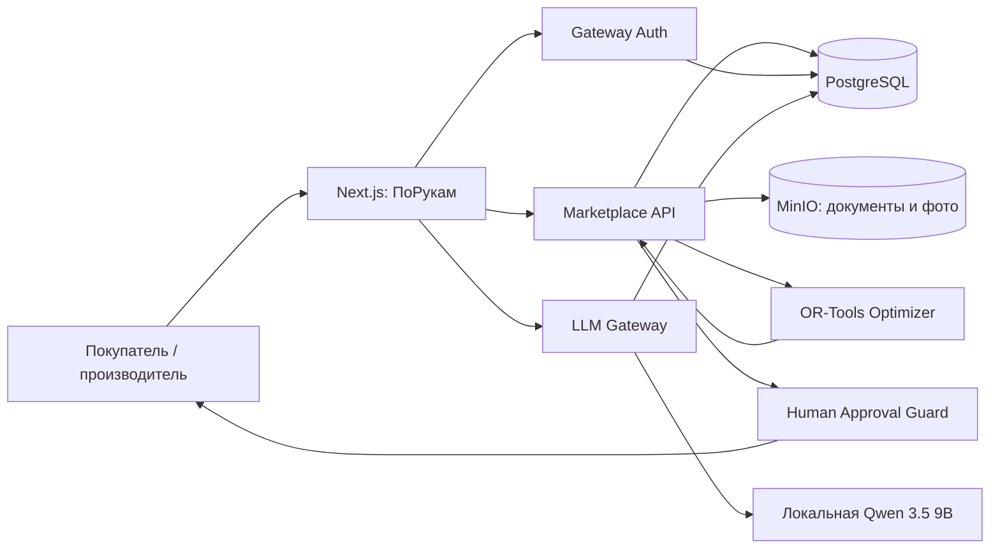

# Архитектура конкурсного прототипа «ПоРукам»

LLM уточняет и объясняет, но не изменяет цену, мощность, резерв или статус сделки. Денежные расчёты, распределение объёма и N-1/N-2 выполняются детерминированным кодом.

Внешняя рыночная разведка в прототипе не обходит защиты сайтов и не рассылает сообщения. Допустимы только ссылки, которые пользователь передал сам, или данные официально подключённого партнёра; источник и дата должны сохраняться, а решение принимает человек.
