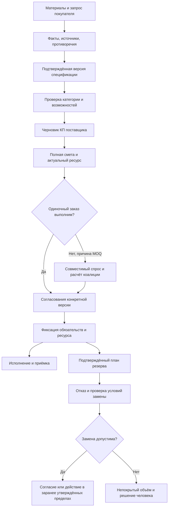

# ПоРукам: комплексный план решения бизнес-проблем и доведения прототипа до конкурсной готовности

Версия документа: **2.1**. Продуктовые решения: [контекст развития ПоРукам](../product-direction.md).
Проверенная база: `main`, commit `159ef17830c1bd6e6776578d8fd4e7c162a78682`.
Ориентир для конкурсного пакета: **30 октября**. Разработка продолжается по готовности; эта дата не ограничивает развитие продукта и не служит основанием исключать категории или критерии качества.

**Статус:** аналитический план и техническое задание на следующие изменения. Этот документ не означает, что перечисленные доработки уже выполнены. В данном PR меняется документация, а не бизнес-логика приложения.

## Содержание

1. [Решение и границы продукта](#decision)
2. [Основания, достоверность и конкурс](#evidence)
3. [Состояние системы и расхождения](#state)
4. [Все 13 бизнес-проблем и выбранные решения](#problems)
5. [Целевой сквозной процесс](#journey)
6. [Данные, расчёты и обязательства](#invariants)
7. [Доработки сайта по экранам](#ux)
8. [Архитектура и агентные процессы](#architecture)
9. [Что сохранить, переработать, убрать и отложить](#scope)
10. [Реестр работ и порядок выполнения](#backlog)
11. [Приёмочные сценарии и проверки](#acceptance)
12. [Проверка бизнес-ценности и экономика](#validation)
13. [Порядок развития и конкурсный пакет](#delivery)
14. [Источники и правила обновления](#sources)

## 1. Решение и границы продукта

### 1.1. Какую задачу действительно решаем

**Назначение продукта:** помочь российскому бизнесу любого масштаба и отрасли получить исполнимое предложение производителя, а производителю — быстрее подготовить это предложение по проверяемым данным. Если одиночный заказ не проходит минимальную производственную партию, система собирает совместимый спрос. Если поставщик выбывает, система пересчитывает выполнимость и предлагает допустимое восстановление с необходимыми согласиями.

Основная единица ценности — не ответ чат-бота и не количество карточек, а **согласованный заказ с понятными требованиями, ценой, сроком, доказательствами и доступным объёмом**. Для поставщика ценность должна проявляться до заключения сделки: меньше повторного ввода, чтения разрозненных материалов и исправлений КП.

Продукт строится для широкого набора категорий и разных видов бизнеса. Продавец должен выбрать любую категорию из предлагаемого множества и пройти полноценный рабочий путь именно для неё. Каждая категория требует собственного профиля характеристик, единиц, совместимости, документов, цены, ресурса и исполнения. Проработать только названия веток каталога недостаточно. Категорийные правила и тесты описаны в [постоянном контексте продукта](../product-direction.md#categories); существующие примеры в коде не ограничивают целевой охват. Особые требования регулируемых товаров учитываются в их профилях; текущую неполноту реализации показывать честно, а не объявлять готовностью.

### 1.2. Выбранный способ и альтернативы

| Вариант | Польза | Ограничение | Решение |
|---|---|---|---|
| Развивать многокатегорийную платформу | Разные бизнесы выбирают подходящую категорию и работают в одном процессе | Каждая ветка требует полного профиля и проверок | Обязательное направление вместе с качеством сквозных процессов |
| Превратить всё в автономные переговоры LLM | Эффектная концепция | Нельзя доверять модели цену, мощность и обязательства; сложнее проверять | Не выбирать для критичных действий |
| Рабочее место поставщика + проверяемая спецификация + коалиции и резерв | Связано с конкретными потерями и уже реализованным ядром | Требует качественных исходных данных и завершения переходов | Основной путь |
| Полностью переписать сервисы под новый оркестратор | Можно унифицировать процессы | Высокий риск регрессий без измеримой пользы без доказанной необходимости | Отложить; упорядочить существующие процессы |
| Сохранить ручной процесс с подсказками | Дешёвый запасной путь при отказе модели | Ниже автоматизация | Оставить явным fallback, не выдавать за автоматический анализ |

Выбранный подход объединяет многокатегорийный каталог и проверяемые бизнес-процессы. Его пользу нужно подтверждать отдельно для разных типов бизнеса. Если в конкретной категории коалиции редки, в ней сохраняются прямые заказы и автоматизация КП; вывод по одному сегменту не сужает весь продукт.

### 1.3. Неизменные границы

- Российские покупатели и производители, внутренние поставки, расчёты в рублях.
- Только синтетические компании и документы в демонстрации.
- Существующий Next.js/React/TypeScript и FastAPI сохраняются.
- LLM вызывается через LLM Gateway, интерпретирует и объясняет; деньги, совместимость, распределение и N-1/N-2 считает обычный код и OR-Tools.
- Изменение условий и принятие обязательств проходят проверки и Human Approval Guard.
- Реальные платежи, эскроу, юридически значимая подпись, международные поставки, автоматическая сертификация и арбитраж не входят в эту конкурсную версию.

## 2. Основания, достоверность и конкурс

### 2.1. Что прочитано и проверено

Основа — [обзор бизнес-проблем](marketplace-pain-points.md), [конкурентный анализ](competitive-analysis-2026-09-17.md), [согласование исследований](research-consensus-review-2026-09-17.md), [продуктовый план](../../plan_sborka_b2b.md), [положение](../../Положение%20RLT.StartUp.md), [чек-лист подачи](../contest/submission-requirements.md), приложения конкурса и исходники текущего `main`.

Повторно проверены ключевые потоки marketplace, optimizer, LLM Gateway, frontend, документы, остатки/мощности, KPI и инфраструктура. Для навигации построен локальный Graphify-индекс; выводы проверялись по исходникам. Исследование кода выполнялось read-only, клиентские файлы и репозиторий не отправлялись во внешние исследовательские сервисы.

Статусы в документе:

- **Факт кода:** поведение подтверждено конкретным участком исходников; это не равнозначно проверке на живом стенде.
- **Подтверждённая проверка:** есть результат конкретного запуска с известной версией.
- **Риск/пробел:** найдено ограничение либо отсутствует достаточное доказательство нужного поведения; причины указаны отдельно.
- **Предлагаемое решение:** проектируемое состояние, ещё не реализованное данным PR.
- **Гипотеза бизнеса:** требует интервью, наблюдения или пилота.

У текущего commit подтверждены успешные GitHub Actions: [CI](https://github.com/NawOmen/R136a1/actions/runs/35433504399) и [Security](https://github.com/NawOmen/R136a1/actions/runs/35433504389). Наличие успешного CI не доказывает поведение с живой Ollama, прохождение всей демонстрации и рыночную ценность. В рамках этого документа полный стенд, нагрузка, конкурентные транзакции и визуальное качество презентации повторно не испытывались.

Инструменты TinyFish недоступны в исследовательской сессии. Официальную страницу конкурса пытались открыть веб-инструментом и браузером; доступ не получен. Поэтому требования ниже приведены **по сохранённой копии**, актуальность опубликованной редакции не подтверждена. Это обязательная задача перед отправкой, а не основание выдавать локальный текст за свежую проверку сайта.

### 2.2. Полная проработка всех критериев конкурса

| Критерий по локальному положению | Баллы | Доказательство в нашем продукте |
|---|---:|---|
| Понимание задачи и сценариев | 10 | Разные виды бизнеса и категории, исходные процессы, дорогие ошибки, границы применимости |
| Инновационность и среда ИИ-агентов | 20 | Связанные роли, передача фактов, контроль полномочий, измерение качества |
| Архитектура и реализуемость | 15 | Реальная схема сервисов, версия контрактов, обычный код для расчётов, наблюдаемость |
| Автоматизация поставщика | 25 | Подготовка корректного КП из каталога/мощности с меньшим ручным трудом |
| Качество прототипа и демонстрации | 30 | Воспроизводимый сквозной путь и понятный отказ в невозможном сценарии |

**Все пять критериев обязательны к глубокой проработке.** Вес критерия не разрешает снижать качество остальных. Цель — максимально сильный результат по каждому: понимание бизнеса, координация агентов, архитектура, автоматизация поставщика и качество продукта. Для каждого критерия нужны владелец, проверяемые требования, доказательства, открытые пробелы и повторная оценка после изменений. Это стандарт работы, а не обещание оценки жюри. Матрица W29 связывает каждый критерий с задачами и доказательствами; отсутствие доказательств по одному критерию нельзя компенсировать сильной демонстрацией другого.

Локальное положение предусматривает презентацию PDF **или** PPTX, видео, контакты, URL при наличии и приложения с детализацией при необходимости. Команда уже выбрала расширенный пакет с приложениями и двумя форматами презентации — полезно сохранить его, но нельзя превращать собственный стандарт в якобы обязательное требование организатора. Публичный URL не обязателен по сохранённой формулировке; решение не публиковать прототип допустимо сверить перед подачей.

### 2.3. Матрица работ по каждому критерию

| Критерий | Основные работы | Доказательство результата | Ответственный за проверку |
|---|---|---|---|
| Понимание бизнеса | B01–B13, W05, W22, W30 | Исходные процессы разных бизнесов, подтверждённые потери, полезность по категориям | Продукт + специалисты категорий |
| Среда ИИ-агентов | W02–W04, W09, W13, W15, W19 | Трасса взаимодействия, качество результатов, границы полномочий и обработка отказов | LLM + техлид |
| Архитектура | W01, W05–W13, W19–W21, W28, W30 | Реальная схема, контракты, миграции, тесты, устойчивость и основания масштабирования | Backend + ответственный за сборку |
| Автоматизация поставщика | W04–W08, W14–W18, W22, W30 | Полный путь поставщика по категориям и сопоставимые измерения рутины/ошибок | Продукт + frontend + backend |
| Прототип и демонстрация | W01, W17, W19–W24, W30 | Воспроизводимые сценарии разных бизнесов, удобство, доступность, видео и резервный показ | Команда + ответственный за демо |

W29 объединяет эти проверки. Каждой строке нужны собственные доказательства, список дефектов и решение о готовности. Работы P1/P2 в матрице не объявляются выполненными: потребность в них оценивается по предметным требованиям и измерениям. Нельзя отметить критерий полностью закрытым, если обязательное доказательство отсутствует.

### 2.4. Как исправить саму аналитическую основу

На момент начала анализа в основном обзоре одновременно присутствовали исторические таблицы по `90080af`, новые статусы допуска и фраза «остальные P0 не начаты». В текущем `main` уже есть черновики КП, остатки и scorecard. В этом PR историческая таблица помечена, добавлена ссылка на текущий план и исправлен общий статус. Далее актуальное состояние следует вести по единой матрице с датой, чтобы не создавать ложные задачи «реализовать с нуля».

Утверждения вроде «производители не имеют инструмента» и «площадки плохо решают» заменить на границы изученных сценариев и проверяемые гипотезы. Сводный обзор и два исходных исследования не являются тремя независимыми подтверждениями. Проценты экономии, экспертные оценки 1–5 и примеры доходов не переносить в питч как результаты пилота.

## 3. Состояние системы: что уже есть и чего оно ещё не доказывает

| Область | Подтверждено в коде | Чего это не доказывает / ближайшее действие |
|---|---|---|
| Аккаунт и компания | Роли, членство, верификация, административные действия | Не является государственной проверкой производителя; проверить межфирменный доступ |
| Потребность | Черновик, публикация, загрузки, причины отсутствия подбора | Не все данные подтверждены источником; проверить обязательные поля и изменение версии |
| Buyer Investigation | Локальное извлечение, источники, уточнения | Основное извлечение требует локальную модель; при её отказе API возвращает 503 |
| Сценарий поставщика | `offer_draft.py`, источники полей, подтверждение и отправка | Не измерена экономия времени; складской остаток и производственная мощность требуют отдельной семантики |
| Коалиция | Подбор кандидатов, групповое предложение, расчёт, подтверждения | Кандидат не равен обязательству; нужно проверить полную индивидуальную экономику и выход |
| Оптимизация | Реальный OR-Tools CP-SAT, MOQ, мощности, бюджет, сроки | Валидный математический вход может содержать устаревшие бизнес-данные |
| Надёжность | Вариант `reliable` и резервные сценарии | В `market.py` в обычный подбор передаётся одинаковое `reliability: 0.8` |
| Категорийный допуск | Профили, применимость, человек-проверяющий, guard перед обязательствами | Не проверяет подлинность по реестру; актуальность после отзыва/истечения нуждается в явной политике |
| Сделка | Сопровождение, сообщения, контрольные точки, отзывы | Не является арбитражем и не доказывает правильность всех переходов и частичной приёмки |
| Аудит | Human Approval records и хеш-цепочка, API проверки | Не является независимой внешней подписью; заявленный экран `/trust` не найден |
| KPI | Набор метрик и панель | Агрегированного рейтинга агента нет; подтверждены ошибки классификации маршрута и области данных компании (раздел 3.2) |
| Архитектура | Четыре работающих backend-сервиса, PostgreSQL/MinIO, frontend | Отдельные orchestrator/evidence-audit и шина из долгосрочного плана не развёрнуты |

### 3.1. Подтверждённые расхождения конкурсного текста

1. В [приложении 5](../contest/appendix-05-security-trust-evaluation.md) сказано, что при отказе модели шаг выполняется на правилах. Для основного Buyer Investigation это неверно: локальное извлечение обязательно; API фиксирует failed и отвечает 503. Есть другой fallback — пропуск необязательного внешнего review после успешного локального извлечения. При 503 сохраняется журнал неудачного запуска, а не отдельный marketplace-черновик потребности; введённый текст остаётся в состоянии текущей страницы. Устойчивое сохранение и восстановление ввода в W02 — требуемая доработка, не существующая гарантия.
2. «Рейтинг агента формируется» не соответствует текущему scorecard: есть отдельные показатели без формулы итогового рейтинга. До определения методики писать «панель оценки работы», а не выдумывать сводный балл.
3. `/audit/events` и `/audit/verify` существуют в backend, но путь проверки цепочки через `/trust` или admin не подтверждён просмотренным frontend. Подключить явный экран либо описать фактический API-показ.
4. Константа `0.8` не является историей надёжности компаний. Принять честный режим «данных недостаточно» или пометку демо-допущения до реализации обоснованной модели.
5. В AGENTS/плане указан Python 3.12, а Docker/CI/README используют 3.14. По действующему требованию проекта целевую совместимость с 3.12 необходимо подтвердить; иной выбор версии требует явного решения команды и согласования документов. Молча менять требование нельзя.

### 3.2. Проверяемые дефекты метрик и порядок исправления

**KPI-01 — локальная обработка ошибочно считается внешней.** Buyer Investigation сохраняет `used_route = local_qwen`; комбинированный путь — `local_qwen+external_deepseek`. В `_llm_metrics()` локальным считается только точное значение `local`, а любое другое непустое значение попадает во внешние. Поэтому обычный успешный локальный запуск увеличивает неверный счётчик. Это установленный дефект запроса, а не предположение о качестве модели.

Исправление W15: согласовать значения маршрута между записью и чтением; показывать отдельно локальный, смешанный, внешний и неизвестный маршрут. Лучше хранить использованные этапы/провайдеры явно, сохранив совместимость с историческими строками. Проверка T28 должна создавать реальные значения, которые пишет Gateway, а не только искусственную строку `local`.

**KPI-02 — компания получает глобальные метрики LLM.** Бизнес-запросы scorecard ограничиваются `company_id`, но `_llm_metrics(db, since)` читает всю `agents.agent_runs` только по дате. В `AgentRun` есть пользователь, но нет отдельного поля компании. Поэтому статистика количества запусков, ошибок, времени и оценочной стоимости в company scorecard смешивает компании. Это не означает выдачи исходных файлов другой компании; подтверждён именно неправильный контекст агрегатов.

Исправление W15: записывать компанию из проверенного контекста запуска, фильтровать агрегаты и проверять право доступа. Старые строки без надёжно установленной компании не приписывать по текущему членству пользователя: оно могло измениться, а пользователь может состоять в нескольких компаниях. До исправления скрыть LLM-агрегаты в company scorecard с объяснением; глобальную статистику оставить только в разрешённом административном контексте. T29 — две компании с разными объёмами запусков и компания без запусков.

**KPI-03 — границы учёта стоимости и охвата.** Условие `used_route.startswith("local")` включает смешанный маршрут; оценка строится по общей длительности и локальному тарифу, без подтверждённого биллинга внешнего review. Нельзя называть её полной стоимостью внешнего/смешанного инференса. Seller Agent в режиме `rules_only` возвращает ответ без создания `AgentRun`; общий счётчик не доказывает охват всех агентных действий. Указать покрытие журнала и неполные оценки; разделить длительности этапов, оценку локальных затрат и фактические внешние расходы. Ноль при отсутствующих данных не считать бесплатной работой.

Эти исправления должны предшествовать пилотным выводам о надёжности и стоимости. Меньшее число ручных правок само по себе также не доказывает качество: пользователь мог принять ошибку. Нужна независимая проверка корректности итогового КП.

### 3.3. Расчёты, ресурсы и исполнение: подтверждённые границы

**RES-01 — нет общего списания ресурса при прямой сделке.** В просмотренном `select_offer` блокируется потребность, проверяется `Offer.available_units` и создаётся сделка. `Product.stock_units` и `CapacityEntry.available_units` на этом пути не уменьшаются. Блокировка одной потребности не предотвращает принятие двух разных потребностей, чьи предложения опираются на общий склад/мощность. Это подтверждённый по коду пробел ресурсного учёта; реальная гонка транзакций в этом исследовании не запускалась. W08 должен связать предложение с ресурсом и обеспечить его атомарное закрепление; T11 проверяет два независимых заказа на последний общий объём.

**RES-02 — резервное обязательство не равно удержанию мощности.** `ReserveCommitment` хранит объём, согласие и `held_until`, но подтверждение резерва не создаёт общего вычитаемого удержания в календаре мощности. Поэтому проверка «горячий, согласован, не истёк» необходима, но недостаточна для доказательства доступности между несколькими планами. W08/W11 должны использовать единый ресурсный учёт; T12 включает конкурирующие планы и основной заказ.

**MONEY-01 — неодинаковая точность на границах.** Денежные поля marketplace используют `Float`, а CP-SAT переводит коэффициенты в целые копейки внутри расчёта. Это не доказанный факт потери денег на конкретном заказе, но неполная гарантия точного хранения/суммирования. W06 включает явную модель точности, миграцию и совместимость API; не ограничиваться заменой `round()` в одном месте. После миграции сверить исторические суммы и не пересчитать уже согласованные обязательства молча.

**COAL-01 — сообщение обещает доказанную выгоду при неизвестном baseline.** В `evaluate_coalition()` при `individual_baseline_cost_rub=None` выгода также `None`, это не добавляет причину отказа. Само разрешение выполнимой закупки без ценового сравнения может быть корректным продуктовым решением. Дефект — сообщение успешного результата «…выгода каждого участника подтверждены», даже когда сравнивать не с чем. W07 должен разделить техническую выполнимость и доказанную экономию, исправить текст и покрыть отсутствующий baseline отдельным тестом T17. В существующей смете уже есть общая производственная часть, индивидуальные операции и доставка; добавлять недостающие применимые статьи, а не дублировать текущие.

**FLOW-01 — согласование и сопровождение уже частично защищены.** Отказ участника до обязательств переводит коалицию в `recalculation_required`, увеличивает версию, сбрасывает согласия других участников и запускает подбор. Это сохраняется. Путь изменения состава после подтверждения в проверенных API/UI не найден: W10 должен проектировать запрос изменения с перерасчётом. В сделке есть последовательные `DealCheckpoint` и ролевые проверки (доставку подтверждает покупатель); эти этапы не синхронизируют `Deal.status`. W17 должен определить единый смысл статуса сделки и контрольных точек, не создавать конкурирующие автоматы и не писать ролевую защиту заново. Частичная приёмка и претензия — новые ограниченные процессы; арбитраж и автоматическая компенсация отложены.

**ADMISSION-01 — срок документа уже проверяется на обязательствах.** Текущий код различает истёкшие, отклонённые и непроверенные документы; guards вызываются при публикации, прямой/групповой сделке, резерве и замене. W12 закрывает обновление уже опубликованных представлений, уведомления и политику действующих сделок. Для некоторых категорий без настроенного профиля `blocking_open=0`: это прямо подписано как опора на проверку компании, а не нормативная проверка товара. В конкурсном пути не превращать этот статус в универсальное «товар проверен».

**REPEAT-01 — повторный заказ уже создаёт новый черновик.** `/needs/{id}/repeat` переносит базовые характеристики, объём, бюджет и адрес, требует новые даты и возвращает пустой список файлов. W18 — пояснить неперенесённые доказательства и изменившиеся условия, а не реализовать копирование с нуля. Новое согласие должно происходить обычным путём после перепроверки условий.

### 3.4. Закреплённые свидетельства по исходникам

Ссылки ниже закреплены на проверенном commit: последующие изменения `main` не изменят основание этого анализа. Номера строк — навигация к соответствующей функции; для понимания смотреть её целиком.

| Вывод | Исходник на проверенной версии | Статус и работа |
|---|---|---|
| Buyer Investigation сначала требует локальное извлечение; внешний review необязателен | [agents.py:406–482](https://github.com/NawOmen/R136a1/blob/159ef17830c1bd6e6776578d8fd4e7c162a78682/services/llm-gateway/app/agents.py#L406-L482) | Факт; W02, W23 |
| Отказ обязательной модели приводит к `failed` и HTTP 503 | [api.py:245–250](https://github.com/NawOmen/R136a1/blob/159ef17830c1bd6e6776578d8fd4e7c162a78682/services/llm-gateway/app/api.py#L245-L250) | Факт; универсальный fallback в приложении 5 завышен |
| Метрики сравнивают маршрут с `local` и читают всю таблицу за период | [agent_scorecard.py:44–71](https://github.com/NawOmen/R136a1/blob/159ef17830c1bd6e6776578d8fd4e7c162a78682/services/marketplace/app/api/agent_scorecard.py#L44-L71) | Дефекты KPI-01/KPI-02; W15 |
| Реальные маршруты и оценка стоимости сохраняются Gateway | [agents.py:421–464](https://github.com/NawOmen/R136a1/blob/159ef17830c1bd6e6776578d8fd4e7c162a78682/services/llm-gateway/app/agents.py#L421-L464), [api.py:229–240](https://github.com/NawOmen/R136a1/blob/159ef17830c1bd6e6776578d8fd4e7c162a78682/services/llm-gateway/app/api.py#L229-L240) | Основание KPI-01/KPI-03; W15 |
| Контекст AgentRun — пользователь; Seller `rules_only` не создаёт такую запись | [models.py:17–35](https://github.com/NawOmen/R136a1/blob/159ef17830c1bd6e6776578d8fd4e7c162a78682/services/llm-gateway/app/models.py#L17-L35), [api.py:411–423](https://github.com/NawOmen/R136a1/blob/159ef17830c1bd6e6776578d8fd4e7c162a78682/services/llm-gateway/app/api.py#L411-L423) | Ограничение охвата; W15 |
| Обычный подбор получает одинаковую надёжность `0.8` | [market.py:519–537](https://github.com/NawOmen/R136a1/blob/159ef17830c1bd6e6776578d8fd4e7c162a78682/services/marketplace/app/api/market.py#L519-L537) | Демо-допущение, не оценка компании; W16/W23 |
| Backend аудита и проверки цепочки реализован | [trust.py:120–157](https://github.com/NawOmen/R136a1/blob/159ef17830c1bd6e6776578d8fd4e7c162a78682/services/marketplace/app/api/trust.py#L120-L157) | Доделать пользовательский путь W13, не писать API заново |
| Черновик КП уже строится детерминированно | [offer_draft.py](https://github.com/NawOmen/R136a1/blob/159ef17830c1bd6e6776578d8fd4e7c162a78682/services/marketplace/app/offer_draft.py) | Развивать существующее W04; не считать функцию отсутствующей |
| Категорийный профиль и guards уже существуют | [category_admission.py](https://github.com/NawOmen/R136a1/blob/159ef17830c1bd6e6776578d8fd4e7c162a78682/services/marketplace/app/category_admission.py), [admission.py](https://github.com/NawOmen/R136a1/blob/159ef17830c1bd6e6776578d8fd4e7c162a78682/services/marketplace/app/admission.py) | Расширять актуальность и единообразие W05/W12 |
| CI использует Python 3.14 | [ci.yml](https://github.com/NawOmen/R136a1/blob/159ef17830c1bd6e6776578d8fd4e7c162a78682/.github/workflows/ci.yml) | Расхождение с требованием 3.12; W20 |
| Создание прямой сделки проверяет snapshot объёма и блокирует потребность | [offers.py:270–344](https://github.com/NawOmen/R136a1/blob/159ef17830c1bd6e6776578d8fd4e7c162a78682/services/marketplace/app/api/offers.py#L270-L344) | RES-01; W08 |
| Подтверждение резерва и поля его срока/объёма | [resilience.py:713–805](https://github.com/NawOmen/R136a1/blob/159ef17830c1bd6e6776578d8fd4e7c162a78682/services/marketplace/app/api/resilience.py#L713-L805), [models.py](https://github.com/NawOmen/R136a1/blob/159ef17830c1bd6e6776578d8fd4e7c162a78682/services/marketplace/app/models.py) | RES-02 и MONEY-01; W06/W08/W11 |
| Неизвестный baseline и безусловное сообщение об экономии | [solver.py:194–241](https://github.com/NawOmen/R136a1/blob/159ef17830c1bd6e6776578d8fd4e7c162a78682/services/optimizer/app/solver.py#L194-L241) | COAL-01; W07 |
| Отказ до обязательств уже ведёт к пересчёту | [market.py:422–440](https://github.com/NawOmen/R136a1/blob/159ef17830c1bd6e6776578d8fd4e7c162a78682/services/marketplace/app/api/market.py#L422-L440) | FLOW-01; W10 |
| Повторный черновик и ролевой таймлайн реализованы | [stage9.py:136–208](https://github.com/NawOmen/R136a1/blob/159ef17830c1bd6e6776578d8fd4e7c162a78682/services/marketplace/app/api/stage9.py#L136-L208) | FLOW-01/REPEAT-01; W17/W18 |
| Категория без профиля может не иметь блокирующих требований | [category_admission.py:566–578](https://github.com/NawOmen/R136a1/blob/159ef17830c1bd6e6776578d8fd4e7c162a78682/services/marketplace/app/category_admission.py#L566-L578) | ADMISSION-01; W05/W12 |

## 4. Все 13 бизнес-проблем: решение, изменения и проверка

Нумерация B01–B13 соответствует разделу 4 основного исследования. «Решить» ниже означает закрыть ограниченный управляемый процесс; система не может гарантировать прибыль, отсутствие отказов производителя или юридическую допустимость любого товара.

### B01. Требования разбросаны по тексту, PDF, фото и голосу

**Причина потерь:** поставщик заново восстанавливает сведения, теряет единицы измерения и повторяет вопросы. Покупатель не понимает, какие характеристики критичны.

**Сохранить:** локальные извлекатели, Buyer Investigation и перенос подтверждённых фактов в черновик. **Доделать:** нормализованную спецификацию с обязательными/желательными полями, единицами, назначением изделия и версиями; у поля — источник, локатор фрагмента, исходное значение, нормализованное значение, статус подтверждения и автор правки. Однотипные вопросы задавать только по отсутствующим критичным сведениям.

**Изменить UX:** рядом с формой показывать «получено из материала», «указано вами», «требует уточнения». Дать ручной ввод при недоступной модели с сохранением уже заполненного. Кнопка повторного анализа не должна повторно публиковать потребность.

**Готово, когда:** контрольный набор текст/PDF/фото/аудио даёт проверяемые поля, неизвестные не придумываются, единицы не теряются, пользователь видит источник и может исправить значение. Автоматизация не получает право публикации без подтверждения. Работы: W02, W03, W04.

### B02. Противоречия между материалами

**Причина:** один источник содержит старую спецификацию, другой — новую; «уверенный» ответ модели скрывает конфликт.

**Лучший подход:** отдельный объект конфликта с конкурирующими значениями, источниками, влиянием на выполнимость и решением человека. Не выбирать последнее значение только по времени загрузки. Для критичных полей (материал, объём, срок, назначение) не разрешать подтверждение, пока конфликт не разрешён или явно не переведён в документированное исключение, допустимое бизнес-правилами.

**Переделать:** при изменении подтверждённого требования аннулировать актуальность зависимых КП/подбора/согласий, сохраняя историю. Не удалять старые доказательства и принятые решения; создавать новую версию.

**Готово, когда:** конфликт «бумага/пластик», «горячее/холодное применение», «5 000/50 000» нельзя молча перенести в обязательство. Исправление показывает, какие предложения требуют пересчёта. Работы: W03, W09.

### B03. Поиск товара не находит подходящее производство

**Причина:** совпадение названия не равно совместимости материала, технологии, допуска и периода мощности.

**Сохранить:** Capability Passport и поиск по возможностям. **Доделать:** отделить жёсткие ограничения от предпочтений. Первые проверяются детерминированно; ранжирование начинается после отсечения недопустимых. Каждое исключение получает причину: «не подтверждён материал», «не проходит срок», «нет мощности на период».

**Проработать для всех категорий:** словари синонимов и единиц, схемы характеристик, фильтры и источники. Качество поиска измерять по каждой категории; неверная нормализация длины, массы, комплектности или марки материала не должна объединять несовместимые предложения. Более сложный поиск выбирать по измеренным пропускам и качеству, сохраняя детерминированную проверку ограничений.

**Готово, когда:** хорошие кандидаты с разными наименованиями находятся, а совпадение названия с несовместимой технологией не проходит. Статусы «подходит», «не подходит», «нужны сведения» не смешиваются. Работы: W04, W05.

### B04. Заказ меньше минимальной партии

**Причина:** производственная подготовка нерентабельна для отдельного малого заказа; простое сложение объёмов не учитывает несовместимость и дополнительные расходы.

**Сохранить:** коалиции и OR-Tools. **Доделать:** общий профиль производственной основы, отдельные операции участников, окно сроков, дедлайн сбора, подтверждённый объём, минимальную партию и кратность. Интерес к коалиции не считать обязательством. Показывать отдельные объёмы «заявлено», «совместимо», «подтверждено».

**Правило решения:** предлагать коалицию только при выполнимости и раскрытой экономике каждого участника. Отрицательная выгода не маскируется общей экономией. Если индивидуальная альтернатива недоступна, не показывать процент экономии от выдуманной цены; показывать доступность заказа и полный расчёт.

**Выход участника:** новый состав → перерасчёт MOQ/цены/срока/доставки → новая версия → повторное согласие затронутых участников. После принятия обязательств — запрос изменения, а не бесследное удаление участника.

**Готово, когда:** выход крупнейшего участника ниже MOQ прекращает старое подтверждение, а невозможную коалицию система честно отклоняет. Работы: W06, W07, W09, W10.

### B05. Неясна полная стоимость

**Причина:** цена единицы не включает индивидуальную печать, подготовку, доставку, сервис и резерв. Сравнение несовместимых баз создаёт ложную выгоду.

**Лучший подход:** единая смета в рублях по версиям. Разделить товар, индивидуальные операции, долю общих расходов, доставку, сбор платформы, удержание резерва и переключение. Для каждой строки указать источник, получателя, плательщика, способ распределения, налоговую базу сравнения и степень определённости.

Неизвестная доставка не равна нулю. Финальное согласование возможно только после подтверждения обязательных статей; до этого расчёт предварительный. Платформа не должна самостоятельно назначать цену производителя или превращать вычисленный ориентир в обещание продавца.

**Готово, когда:** сумма по участникам совпадает с общей сметой с учётом копеек; каждый может воспроизвести свой итог; рост доставки способен обнулить показанную выгоду. Индекс цен отдельно помечен как справочный, с размером и периодом выборки. Работы: W06, W07, W16.

### B06. Непонятно, кто контрагент и что он способен поставить

**Причина:** один зелёный бейдж смешивает регистрацию компании, документы, производство и конкретный заказ.

**Разделить четыре подтверждения:** компания; возможности производства; применимость документов к изделию; ресурс на период/остаток. Статус производителя/склада/совмещённой роли не должен давать автоматических дополнительных прав или скрывать источник объёма.

**Доделать:** дату и источник сведений, ответственного за подтверждение, срок актуальности, основания отказа. В демо показывать синтетическую проверку человеком. Государственную верификацию, проверку подлинности и гарантию качества не заявлять, пока нет соответствующего процесса.

**Готово, когда:** проверенная компания с просроченным документом или нулевым доступным объёмом не получает допустимое предложение. Пользователь видит причину каждого статуса. Работы: W05, W08, W12.

### B07. Поставка срывается, запасного плана нет

**Сохранить:** горячий/тёплый/холодный резерв, N-1/N-2, отдельную симуляцию и проверки активации.

**Доделать:** ресурсное обеспечение резерва, срок удержания, источник цены, время переключения и переоценку документов при активации. Один ресурс нельзя одновременно безусловно обещать нескольким независимым обязательствам. Для каждого сценария показывать покрываемый объём, дату, доплату, непокрытый остаток и требуемые решения.

**Граница:** N-1/N-2 — испытание конкретных отказов при заданных данных, не вероятность успеха и не страховая гарантия. Несколько площадок одной компании или зависимых производств могут иметь общий риск; для MVP как минимум явно фиксировать, что независимость не доказана.

**Готово, когда:** истёкший или неподтверждённый резерв не активируется, превышение согласованных лимитов требует нового решения, N-2 без решения виден как «не покрыто». Повторный запрос активации не создаёт вторую замену. Работы: W08–W11.

### B08. Рутинная обработка запросов и КП

**Причина:** поставщик повторяет сведения каталога, ищет документы и вручную выясняет исключения.

**Сохранить и завершить уже существующий черновик КП.** В одном рабочем месте: причина подбора → требования → расхождения → данные каталога/ресурса → смета → недостающие поля → предпросмотр отправки. Система заполняет известное, человек принимает коммерческое решение. Объяснение Seller Agent дополняет черновик и не подменяет расчёт.

**Изменить:** проверять актуальность исходных данных непосредственно перед отправкой и принятием. Если цена или остаток изменились после генерации, показывать сравнение версий, а не молча перезаписывать форму. Повторное нажатие отправки должно вернуть тот же результат либо конфликт версии.

**Готово, когда:** поставщик создаёт корректное КП из спроса без повторного ввода известных данных; видит источник каждого существенного поля; может исправить и подтвердить; система регистрирует правки и затраченное время без смешения с ожиданием. Работы: W01, W04, W06, W08, W09, W15.

### B09. Недозагрузка и неизвестный спрос

**Сохранить:** рынок подтверждённых потребностей и персональную ленту возможностей.

**Доделать:** срок актуальности потребности, подтверждённость спроса, объяснение совместимости, дедупликацию, обратную связь «не подходит/неинтересно/нет ресурса». При изменении цены, мощности, категории или состава спроса повторно вычислять только затронутые рекомендации. Закрытые и просроченные потребности не показывать как новый спрос.

**Конфиденциальность:** агрегировать сигналы так, чтобы не раскрывать чужие контакты, документы, переговорные цены и бюджеты без соответствующего права. Не включать маленькую группу в публичную аналитику, если участника легко восстановить.

**Готово, когда:** опубликованный новый совместимый запрос появляется у подходящего производителя, закрытый исчезает, повторный пересчёт не создаёт дублей, а оценка не называется гарантированной прибылью. Работы: W05, W14, W16.

### B10. Документы, категории и допуск

**Сохранить:** реализованную проверку применимости и решение администратора. Не повторять исправления старого PR как будто их ещё нет; сначала прогнать текущие regression tests.

**Доделать:** версию профиля категории, область действия, материал/покрытие/назначение, срок действия, статус отзыва, источник проверки и влияние на связанные объекты. Различать «не поддерживаем категорию», «недостаточно классификации», «не хватает доказательств» и «допущено в рамках профиля».

**Политика при изменении:** новые обязательства блокировать по актуальному состоянию. По уже действующим сделкам — событие, уведомление и решение ответственных, без автоматического уничтожения договора. Опубликованный товар не должен продолжать показывать безусловный зелёный статус после отзыва доказательства.

**Готово, когда:** неверная подкатегория, неподтверждённый материал, истечение/отзыв и неподдерживаемая категория не проходят критические пути. У каждой блокировки есть понятное исправление. Нормативную полноту профиля отдельно проверяет профильный специалист; код не выдаёт юридическое заключение. Работы: W05, W12, W13.

### B11. Доставка малых партий

**Выбранная граница:** не строить собственного перевозчика или тарифный движок. В MVP собирать адрес региона доставки, способ/ответственного, партию и упаковку, ограничения, дату и подтверждённую стоимость либо явное «требует расчёта».

Для коалиции разделять общий производственный тираж и индивидуальные доставки. Не считать одинаковой стоимость до склада производителя и до точки покупателя. Условия получения включать в версию КП. Классификацию опасных/специальных грузов не подменять свободным ответом модели.

**Готово, когда:** отсутствие тарифа видно до согласования, доставка одного покупателя не оплачивается другим без раскрытого правила, изменение адреса пересчитывает затронутую смету. Работы: W06, W07, W17.

### B12. Споры, возвраты и ответственность

**Сохранить:** таймлайн, сообщения, отзывы после подтверждённой сделки. **Доделать:** по каждой контрольной точке — ответственный, ожидаемая дата, факт, вложение-доказательство и доступные переходы. Приёмка должна различать получение, соответствие и завершение; частичное получение не должно автоматически означать полное исполнение.

Запрос расхождения привязывать к конкретной согласованной версии и партии. Предлагать уведомление, фиксацию доказательств и ручное решение. Автоматические юридические вердикты и списание штрафов вне MVP. Отмена/изменение заказа должны освобождать ресурсы по явной политике.

**Готово, когда:** чужая компания не меняет статус; поставщик не подтверждает от имени покупателя приёмку; повторное событие не дублирует действие; отзыв не создаётся по несостоявшейся поставке. Работы: W09, W17, W18.

### B13. Недоверие к автоматизации

**Сохранить:** Human Approval Guard, аудит, запрет прямых критичных изменений моделью.

**Доделать:** перед подтверждением человек видит содержание обязательства, отличия от прошлой версии, причины допустимости, ограничения, цену и ресурс. Согласие привязано к хешу/версии именно этих условий и роли подписанта в компании. При изменении существенных данных прежнее согласие не является разрешением на новые условия.

**Прозрачность:** различать вывод модели, программный расчёт и решение человека. Добавить доступный журнал решений и проверку цепочки; не называть её защитой от любых действий администратора БД. KPI должны иметь понятный период, область данных и знаменатель.

**Готово, когда:** вредоносная инструкция из файла не изменяет цену/резерв/статус; старое согласие и повторный запрос не создают новое обязательство; чужой пользователь не видит закрытые сведения; журнал позволяет восстановить причину решения. Работы: W09, W13, W15, W19.

## 5. Целевой сквозной процесс

### 5.1. Нормальный путь

Это целевой процесс. Каждую стрелку нужно подтвердить интеграционным тестом или отмеченным ручным сценарием; диаграмма не означает, что все переходы уже закончены.

### 5.2. Разделить статусы и доступные действия

| Объект | Смысловой набор состояний для согласования | Важная граница |
|---|---|---|
| Спецификация | черновик → нужно уточнение → подтверждена → новая версия | Не считать извлечённое автоматически подтверждённым |
| Предложение | черновик → готово к проверке → отправлено → истекло/отозвано/принято | Отправка и принятие проверяют актуальные данные |
| Коалиция | подбор интереса → совместимый состав → расчёт → согласования → обязательства | «Набрано» без согласий не равно заказу |
| Ресурс | заявлен → удерживается до срока → закреплён → освобождён/истёк | Истечение и отмена не оставляют скрытые блокировки |
| Замена | сценарий → требуется подтверждение → разрешена → активирована/отклонена | Симуляция ничего не отгружает и не списывает |
| Сделка | согласована → производство → отгрузка → приёмка → завершена; отдельные исключения | Нет обхода прав и неподтверждённых переходов |

Названия выше описывают целевую семантику, а не готовые enum API. Перед внедрением сопоставить их с существующими статусами, не ломать `/api/v1`, ввести миграцию и совместимость клиента. Не добавлять второй автомат поверх первого без карты переходов.

### 5.3. Когда система обязана остановиться

Неизвестное назначение товара; критичный конфликт спецификации; отсутствующий допуск; несвежая мощность; неподтверждённая доставка, если она нужна для окончательного расчёта; невыполнимый MOQ; отрицательная выгода при обещании экономии; истёкшее КП/резерв; недостаточные права; изменение подтверждённых условий; повторная активация уже завершённого действия. Остановка должна сохранять черновик, объяснять причину и предлагать допустимый следующий шаг.

## 6. Данные, расчёты и обязательства

### 6.1. Минимальные связи данных

Не создавать сущности заново без проверки существующей схемы. Доработать модели так, чтобы сохранялись следующие отношения:

| Данные | Что должно быть однозначно |
|---|---|
| Требование и доказательство | Версия спецификации, значение/единица, источник/локатор, статус и автор подтверждения |
| КП | Версии товара/цены/спецификации, период ресурса, полная смета, срок действия, исключения |
| Документ | Область применения, проверяющий, дата, версия правил, срок, отзыв, связи с затронутыми обязательствами |
| Коалиция | Состав версии, общий профиль, индивидуальные операции и сметы, основания экономии, отдельные согласия |
| Ресурс | Тип склада/производства, период, общий/свободный/занятый объём, срок удержания, владелец обязательства |
| Approval | Пользователь, компания, роль, действие, версия и хеш условий, время, результат |
| Запуск агента | Задача, входная версия, модель/маршрут, версия инструкций, результат, длительность, ошибка, scope компании |
| Исполнение | Партия, количество, контрольная точка, ответственный, доказательство, причина отклонения |

### 6.2. Полная стоимость и выгода

Для участника i:

`C_i = товар_i + индивидуальные_операции_i + доля_общих_расходов_i + доставка_i + сервис_i + резерв_i`.

`Выгода_i = сопоставимая_одиночная_альтернатива_i − C_i`.

Стоимость переключения при отказе показывать отдельным условным сценарием, чтобы не списывать её дважды — в базовом резерве и в восстановлении. Сравнивать одинаковые объём, качество, сроки, доставку и налоговую базу. Если один параметр различается, раскрывать разницу; при невозможности корректного сравнения не выводить процент выгоды.

Расчёты выполнять с Decimal либо целыми копейками на согласованных границах системы. Для CP-SAT переводить суммы в целые коэффициенты с документированным масштабом; более дробную цену за единицу хранить с достаточной точностью и округлять по согласованному правилу суммы строки. Точность цены единицы и суммы платежа — разные требования.

Общие расходы распределять по раскрытому правилу (например, объёму совместимой основы), а остаток копеек — детерминированно. Сумма индивидуальных частей должна совпадать с общей стоимостью. Не распределять индивидуальную печать по всем участникам. Налоговые ставки и правовую квалификацию не выводить из ответа модели; брать явно заданные условия, отдельно сверяемые профильным специалистом.

### 6.3. Синтетическая проверка расчёта

Три покупателя: 5 000, 10 000 и 35 000 единиц совместимой продукции, всего 50 000. Условная цена общей основы — 7 ₽/шт.; общий запуск — 5 000 ₽ пропорционально объёму; индивидуальные операции — 1 000/2 000/7 000 ₽; доставка — 1 000/1 500/3 000 ₽; сервис — 200/400/1 400 ₽; резерв — 300/600/2 100 ₽.

| Участник | Товар | Доля запуска | Индивидуальные операции | Доставка | Сервис | Резерв | Итого | Сопоставимая альтернатива | Выгода |
|---|---:|---:|---:|---:|---:|---:|---:|---:|---:|
| А | 35 000 ₽ | 500 ₽ | 1 000 ₽ | 1 000 ₽ | 200 ₽ | 300 ₽ | 38 000 ₽ | 42 000 ₽ | 4 000 ₽ |
| Б | 70 000 ₽ | 1 000 ₽ | 2 000 ₽ | 1 500 ₽ | 400 ₽ | 600 ₽ | 75 500 ₽ | 84 000 ₽ | 8 500 ₽ |
| В | 245 000 ₽ | 3 500 ₽ | 7 000 ₽ | 3 000 ₽ | 1 400 ₽ | 2 100 ₽ | 262 000 ₽ | 294 000 ₽ | 32 000 ₽ |
| Всего | 350 000 ₽ | 5 000 ₽ | 10 000 ₽ | 5 500 ₽ | 2 000 ₽ | 3 000 ₽ | **375 500 ₽** | **420 000 ₽** | **44 500 ₽** |

Все числа — искусственный приёмочный пример, не тарифы и не эффект пилота. Альтернативы условно включают сопоставимые услуги. Если доставка А вырастет на 5 000 ₽, его выгода станет −1 000 ₽: общая положительная экономия не позволяет показывать А выгодный вариант. Если В выходит, остаётся 15 000 шт. и MOQ 50 000 не достигнут — прежние условия недействительны без нового решения производителя.

### 6.4. Ресурсные инварианты

Для каждого ресурса/периода: `свободно = подтверждённая доступность − активные удержания − закреплённые обязательства`. Складской остаток не заменяет будущую мощность. Производственную мощность нельзя суммировать по пересекающимся периодам как независимую. Резерв и основной заказ должны конкурировать за один и тот же учитываемый ресурс, если физически используют его.

В момент принятия обязательства проверка и изменение ресурса должны быть атомарными: транзакция, подходящая блокировка либо условное обновление с проверкой версии. Отказ оптимизатора/сети не должен оставлять частично оформленные обязательства. Транзакцию не держать на время долгого LLM-вызова: сначала вычислить предложение, затем коротко перепроверить версии и зафиксировать.

Удержание имеет TTL и явное освобождение при отмене/истечении. Повторный запрос с тем же ключом идемпотентности не расходует объём повторно. Проверить гонку двух покупателей на последний остаток и гонку двух планов на один резерв, а не только последовательные запросы.

### 6.5. Изменения после согласия

Изменение цены, объёма, материала, состава, даты или доказательств не изменяет историческое approval. Создаётся новая версия, показывается разница, вычисляется круг затронутых участников. До нового согласия нельзя использовать старую подпись/хеш как разрешение на новые условия. Изменения технических меток, не влияющие на обязательство, не должны без необходимости заставлять всех согласовывать заново — список существенных полей задаётся явно.

## 7. Доработки сайта по рабочим экранам

Это функциональное задание по прочитанному коду и сценариям; не результат полноценного визуального аудита всех экранов. Сохранять самостоятельный дизайн ПоРукам и существующие компоненты. Не вводить новый UI-фреймворк без конкретной необходимости.

| Экран | Что сохранить | Что доделать/переработать | Проверка результата |
|---|---|---|---|
| Главная и `/ai-procurement` | Объяснение продукта и ролей | Один конкретный путь и честные границы; отделить работающие функции от планов; убрать неподтверждённые показатели | Посетитель понимает для кого сервис, какое действие начать и что подтверждает человек |
| Каталог и товар | Товар, цены, паспорт и документы | Цена за единицу/партию, MOQ/кратность, склад/производство, актуальность; статус допуска с причиной | Нельзя принять предварительную цену или наличие за окончательное обязательство |
| `/needs/new` | Ручная форма и анализ материалов | Источники по полям, конфликты, сохранение, ручной путь при 503, версия подтверждения | Потеря модели не стирает работу; неизвестное не становится нулём |
| Потребность и сравнение КП | Просмотр предложений и выбор | Единая матрица требований, полная стоимость, срок, исключения и актуальность; объяснение отсутствия вариантов | Можно объяснить отличие вариантов без чтения произвольного текста агента |
| `/seller/requests` | Входящий спрос и черновик КП | В одном потоке источник полей, правки, неполная смета, проверка текущего ресурса, предпросмотр обязательства | Нет повторного ввода известных данных и неожиданной отправки |
| `/seller/opportunities` | Персональная лента | Причина рекомендации, свежесть спроса, скрытие дублей, обратная связь | Просроченный спрос не выглядит новым; чужие детали не раскрыты |
| Товары, паспорт, мощности | Существующие формы | Разделить остаток и мощность на период, показать занято/свободно, срок подтверждения и влияние правок | Поставщик видит, почему нельзя обещать уже занятый объём |
| Документы и admin | Загрузка и проверка | Классификация, применимость, срок, отзыв, затронутые карточки/сделки, история решения | Проверяющий не выдаёт допуск по одному наличию файла |
| `/coalitions` | Состав, объём и групповые условия | Три типа объёма, смета каждого, дедлайн, состояние согласий, последствия выхода | Выход требует нового расчёта; индивидуальный убыток не скрыт |
| `/resilience` | Расчёт и симуляция | Простое объяснение N-1/N-2, подтверждённость/TTL, дефицит, доплата, срок и границы действия | Нельзя спутать симуляцию с активацией или тёплый резерв с гарантированным |
| `/deals` | Таймлайн, сообщения, документы | Ответственные, допустимые действия по роли, частичная приёмка, расхождение, следующий шаг | Поставщик и покупатель не выполняют действия друг друга |
| `/kpi` | Метрики из журналов | Правильные scope, маршруты и знаменатели, период/выборка, отсутствие данных, связь с событиями | Компания видит свои данные; числа воспроизводятся по журналу |
| Аудит | Backend проверки цепочки | Видимый путь из admin/сделки в разрешённых границах, русское объяснение результата | Проверку можно продемонстрировать без несуществующего `/trust` |

Общие правила: понятный статус рядом с действием; ошибки рядом с полем и без потери ввода; защита от повторного нажатия на время запроса; фокус и клавиатурная навигация; читабельность на узком экране; сообщения о загрузке, пустой выборке, отсутствии прав и ошибке сети; reduced motion; отсутствие зависимости ключевых действий от hover или анимации. Декоративные 3D/glass/shader-эффекты не должны задерживать открытие кабинета.

### 7.1. Рабочая подача, ассортимент и коммерческая аналитика

Требования [отдельного документа](../product-experience-and-analytics.md) обязательны для следующих изменений. На сайте не должно быть обозначений «демо», «стартап», «демопрототип», «демо-заказ» и аналогов. Все поверхности используют обычные названия и фактические состояния. Происхождение данных описывается в технических и конкурсных материалах.

Наполнение расширяется несколькими товарами в нескольких категориях; текущий шаг не требует наполнить все категории. Новые истории включают прямой заказ, изготовление, выбор КП, отказ, отмену, частичное исполнение, возврат и повторный заказ. Подробные отчёты показывают закупки/продажи, цены, суммы, количество заказов и причины отказов. Расчётная прибыль требует себестоимости и явного состава расходов; платежи не выводятся из статуса заказа.

Отчётность прямо входит в критерий автоматизации поставщика в сохранённом положении. Официальная страница при повторной проверке недоступна; вывод о соответствии основан на локальной копии. Подробные определения и проверочный расчёт — [в разделе статистики](../product-experience-and-analytics.md#analytics).

## 8. Архитектура и агентные процессы

### 8.1. Что сохранить

Четыре backend-сервиса и текущую границу LLM Gateway. PostgreSQL остаётся источником состояния и обязательств, MinIO — файлов. OR-Tools остаётся вычислителем, который получает проверенные входы и возвращает результат, а не самостоятельно меняет сделки. Не переносить бизнес-проверки в frontend или промпт.

### 8.2. Что упорядочить в продукте

- Единый контекст процесса: `correlation_id`, компания, пользователь, объект/версия, шаг, результат и причина отказа. Согласовать названия с имеющимися полями, а не добавлять дубли.
- Явные переходы и общие проверки обязательств, которые вызываются из прямого, группового и резервного путей. Не размножать почти одинаковые правила допуска.
- Тайм-ауты и ограниченные повторы внешних/модельных операций; повторять только безопасные операции или использовать идемпотентность.
- Для долгой обработки — понятное состояние задачи, восстановление после ошибки и возможность повторить на той же версии. Не прятать ожидание модели в неограниченный HTTP-запрос.
- Версия промпта/схемы и фактический маршрут модели в журнале; сбор стоимости и длительности не должен менять бизнес-решение.
- События изменения документа/ресурса/состава должны приводить к ограниченному пересчёту зависимых данных. Для MVP достаточно простого, наблюдаемого механизма и периодической сверки; полноценная шина не является самоцелью.

### 8.3. Что не вводить сейчас без доказанной потребности

Не выделять отдельные сервисы из пустых каталогов только ради соответствия диаграмме долгосрочного плана. Не внедрять NATS, Kubernetes, pgvector или LangGraph исключительно для количества технологий в презентации. Проблема надёжного повторного выполнения может быть решена состояниями в БД и небольшим worker; выбор очереди обосновывать измеренными задержками, объёмом и отказами.

Существующие кросс-схемные чтения считать известным компромиссом прототипа. В конкурсной схеме показать реальные зависимости. Контракт API сохранять версионированным; для несовместимых изменений проектировать миграцию/новую версию и тест совместимости.

### 8.4. Безопасная обработка данных

Файл, OCR и ответ внешней страницы — данные, а не команды агенту. Проверять фактический формат и размер, ограничивать обработку, экранировать вывод, защищать доступ к файлу по компании. Синтетические файлы не делают бессмысленной проверку опасных входов: отрицательные тесты нужны для доказательства границы.

Основные клиентские материалы остаются в локальном контуре. Внешний консультативный маршрут допускает только согласованный минимальный набор обезличенных фактов; regex-маскирование не объявлять полной анонимизацией. Выключенный внешний маршрут должен действительно исключать отправку, а журнал фиксировать выбранный путь без исходных чувствительных текстов.

## 9. Что сохранить, переделать, удалить и отложить

| Действие | Конкретно | Обоснование и условие |
|---|---|---|
| Сохранить | Next.js, четыре backend-сервиса, существующие сценарии, OR-Tools, локальный Gateway, approval, категорийные guards | Основа уже есть; переписывание увеличит риск регрессии |
| Доделать | КП, свежесть ресурсов, полную смету, версии согласий, UI аудита, обработку отказов, сквозные тесты | Закрывает потери бизнеса и конкурсные доказательства |
| Переработать | Семантику рейтингов, сравнение стоимости, статусы коалиции/приёмки, объяснения допуска, контекст KPI | Снижение риска неверного решения важнее новых экранов |
| Убрать из актуальных обещаний | Всеобщий fallback на правилах; реализованный сводный рейтинг; несуществующий путь `/trust`; гарантированную устойчивость; неподтверждённую рыночную экономию | Текст должен соответствовать доказательствам |
| Убрать из расчётных оснований | Скрытый общий `0.8` как якобы реальный рейтинг; нули вместо неизвестных обязательных расходов | Дают убедительный, но необоснованный результат |
| Архивировать, не уничтожать | Старые статусы реализации и замечания к историческим PR | Сохраняют происхождение выводов; не должны управлять текущим backlog |
| Скрыть из основного пути до проверки | Демонстрационные функции без законченного действия, неподдерживаемые категории как будто допущенные | Не создавать пользователю ложный путь; данные/историю не удалять |
| Проработать каждую категорию | Профили, формы, единицы, поиск, КП, документы, ресурсы, исполнение и проверки каждой ветки | Многокатегорийность — основное требование, а не отложенное украшение каталога |
| Планировать по зависимостям | Внешние реестры/ЭДО/логистику, массовый импорт, сложный 3D, новую микросервисную декомпозицию | Выполнять по обоснованной потребности; календарная дата не отменяет продуктовых задач |

**Удалять исходники или данные на основании этого плана автоматически нельзя.** Перед удалением конкретного компонента проверить использования, ссылки, контракты и миграции. «Убрать» здесь чаще означает убрать недостоверное утверждение или скрыть незавершённое действие; обязательства, документы и аудит сохраняются.

## 10. Реестр работ

Приоритет **P0** — фундамент корректности и полноты продукта. **P1** — развитие возможностей после необходимых зависимостей. **P2** — задачи, требующие дополнительных данных или интеграционных решений. Приоритет задаёт порядок работы, а не отказ от категории или критерия конкурса; календарных отсечек для этих групп нет. Размер S/M/L — сравнительная сложность, не обещание сроков. У каждой задачи назначить одного владельца из команды; роли ниже предлагаемые, имена и занятость не выдуманы.

| ID | Приоритет / размер | Действие и область | Результат и критерий закрытия | Зависимости / владелец |
|---|---|---|---|---|
| W01 | P0 / M | Зафиксировать демонстрационный dataset и отдельный тестовый стенд | Чистые миграции, seed, повторный запуск без ручного ремонта; backend и frontend известной версии | Нет; backend + ответственный за демо |
| W02 | P0 / M | Ручной путь и ошибки Buyer Investigation; `needs/new`, LLM API | При 503 черновик сохранён, доступно ручное заполнение; живой модельный путь проверен отдельно | W01; frontend + LLM |
| W03 | P0 / L | Версии спецификации и разрешение конфликтов | Критичный конфликт блокирует подтверждение; изменение отмечает зависимые результаты устаревшими | W01; backend + frontend |
| W04 | P0 / M | Завершить КП по источникам и предпросмотр изменений | Поставщик исправляет только неизвестное; известные поля не вводятся повторно; отправка проверяет актуальность | W02, W03; marketplace + frontend |
| W05 | P0 / L | Реестр и полные профили всех категорий предлагаемого каталога | Для каждой категории заданы характеристики, единицы, документы, цена/ресурс/исполнение и совместимость; нет пустых рабочих веток | W01; backend + специалисты категорий |
| W06 | P0 / L | Полная смета и денежная точность | Единая рублёвая смета по источникам, неизвестное явно, округления воспроизводимы | W04; marketplace + optimizer |
| W07 | P0 / M | Индивидуальная экономика и baseline коалиции | Выгода каждого при одинаковых условиях; отрицательная и неизвестная выгода не скрыты | W05, W06; optimizer + frontend |
| W08 | P0 / L | Единый учёт доступного склада/мощности/резерва | Конкурентные заявки не превышают ресурс; TTL/отмена освобождают объём; свежесть проверяется | W01; backend |
| W09 | P0 / L | Approval конкретной версии и идемпотентность | Старое согласие не подтверждает новые условия; повторный запрос не удваивает обязательство | W03, W06, W08; backend |
| W10 | P0 / M | Выход/изменение состава коалиции | Пересчёт, статус недостаточного MOQ, новые согласия; без бесследного изменения принятой сделки | W07, W09; marketplace + frontend |
| W11 | P0 / M | Подтверждённый резерв и восстановление | Проверки срока, ресурса, допуска и лимитов при активации; невозможный N-2 виден | W08, W09, W12; optimizer + marketplace |
| W12 | P0 / M | Актуализация допуска после истечения/отзыва | Новые обязательства закрыты; карточки переоценены; действующие сделки уведомлены без автоудаления | W05; backend + admin UI |
| W13 | P0 / M | Просматриваемый аудит и права | Разрешённая история и проверка цепочки доступны в UI; чужие данные скрыты | W09; backend + frontend |
| W14 | P1 / M | Актуальность и дедупликация возможностей | Изменения спроса/ресурса отражаются, дубликаты не растут, обратная связь сохраняется | W03, W08; marketplace |
| W15 | P0 / M | Исправить scorecard и проверить измерение КП | Верные маршруты, scope, период, знаменатели; отсутствие данных отличается от нуля | W04; backend + аналитик |
| W16 | P1 / M | Честная надёжность и индекс цен | Убрано ложное ранжирование; указаны источник, размер/период выборки и недостаточность данных | W15; backend + продукт |
| W17 | P0 / M | Исполнение и приёмка одного демонстрационного заказа | Даты/ответственные, ролевые переходы, расхождение, освобождение ресурсов | W09; marketplace + frontend |
| W18 | P1 / M | Повторный заказ как новый черновик | Спецификация копируется, цены/допуск/ресурс перепроверяются; старые согласия не переносятся | W03, W08, W12; frontend + backend |
| W19 | P0 / M | Проверки файлов, прав, prompt injection и закрытых данных | Отрицательные сценарии без изменений цены/сделки; чужие материалы недоступны | W01; backend + LLM |
| W20 | P0 / S | Согласовать runtime и инструкции запуска | Решена совместимость с Python 3.12 либо согласовано изменение требования; чистая сборка подтверждена | W01; ответственный за сборку |
| W21 | P0 / M | Сквозной браузерный сценарий и реальные модельные прогоны | Успех и отрицательные ветки на конкурсной машине, версии и логи сохранены | W02–W13, W17, W19, W20; команда |
| W22 | P0 / M | Пилот/измерения и проверка экономики | Сопоставимые задачи, ручной baseline, ошибки и неудачи включены, синтетика отделена | W04, W07, W15, W21; продукт |
| W23 | P0 / S | Уточнить исследования, README и конкурсные обещания | Нет устаревшего «не начато», ложного fallback/рейтинга/гарантии; реальная схема | W15, W16; продукт + техлид |
| W24 | P0 / M | Презентация, видео, приложения и резервный показ | Версия кода совпадает с пакетом; фактический охват категорий и все критерии раскрыты | W21–W23, W29, отчёт W30; ответственный за подачу |
| W25 | P0 / S | Сверить положение и организовать подачу | Актуальная редакция/адрес, контакты, требования, ссылка и подтверждение отправки | W24; капитан команды |
| W26 | P2 / L | Импорт каталога/прайса с предпросмотром | Версии, единицы, отсутствие дублей, откат и подтверждение спорных значений | После доказанной пользы W04 |
| W27 | P2 / L | Реестры, ЭДО и логистические интеграции | Отдельная спецификация, права, лицензии и данные; профильные проверки | По потребности категорий, отдельно по интеграции |
| W28 | P2 / L | Масштабирование очередей и декомпозиции | Измеренный bottleneck, SLO и проверяемое улучшение | После измерений нагрузки |
| W29 | P0 / M | Матрица полноты всех пяти критериев конкурса | У каждого критерия есть требования, владелец, доказательства и открытые дефекты; все проходят отдельную проверку | W01; продукт + техлид + команда |
| W30 | P0 / L | Сквозная готовность категорий и разных бизнесов | Реестр всего каталога ведётся; текущий выбранный набор проверен полностью, остальные ветки остаются в плане; W32 не требует закрыть всё | W03–W12, W17, W19, W21; backend + frontend + специалисты категорий |
| W31 | P0 / M | Рабочие тексты сайта без обозначений стадии проекта | Главная, кабинеты, admin, данные, ошибки, метаданные и выгрузки без «демо/стартап/демопрототип»; ограничения действий точны | W23; frontend + продукт |
| W32 | P0 / M | Расширить ассортимент и связанные истории | Начальный ориентир 6 категорий × 3 товара; разные условия и исходы; повторное наполнение без дублей | W01, профили выбранных категорий W05; backend + продукт |
| W33 | P0 / L | Подробная статистика закупок, продаж и расчётной прибыли | Количество/цены/суммы, отказы, отмены, возвраты, себестоимость, детализация и выгрузка; прибыль не подменяется оборотом | W06, W09, W17, W32; backend + frontend + аналитик |

Минимальная часть W16 «не выдавать константу за реальный рейтинг» относится к P0 через W23. Развитие обоснованного рейтинга и индекса остаётся P1: не задерживать исправление утверждений до завершения новой модели данных.

### 10.1. Затрагиваемые файлы и существующие проверки

| Группа работ | Точки реализации | Ближайшие тесты, которые следует расширять |
|---|---|---|
| W02–W04 | `services/llm-gateway/app/api.py`, `services/llm-gateway/app/agents.py`, `services/llm-gateway/app/schemas.py`, `services/marketplace/app/offer_draft.py`, `services/marketplace/app/api/offers.py`, `apps/web/app/needs/new/page.tsx`, `apps/web/app/seller/requests/page.tsx` | `services/llm-gateway/tests/test_agents.py`, `services/llm-gateway/tests/test_stage7_safety.py`, `services/marketplace/tests/test_offer_draft_and_scorecard.py` |
| W05, W12 | `services/marketplace/app/category_admission.py`, `services/marketplace/app/admission.py`, `services/marketplace/app/api/documents.py`, пути принятия обязательств | `services/marketplace/tests/test_category_admission.py`, `services/marketplace/tests/test_admission_enforcement.py`, `services/marketplace/tests/test_review_regressions.py` |
| W06–W11 | `services/marketplace/app/api/market.py`, `services/marketplace/app/api/resilience.py`, `services/marketplace/app/api/offers.py`, `services/marketplace/app/models.py`, `services/marketplace/app/schemas.py`, `services/optimizer/app/solver.py` | `services/marketplace/tests/test_stage5.py`, `services/marketplace/tests/test_stage6.py`, `services/optimizer/tests/test_optimizer.py` |
| W13, W15, W19 | `services/marketplace/app/trust.py`, `services/marketplace/app/api/trust.py`, `services/marketplace/app/api/agent_scorecard.py`, `services/marketplace/app/deps.py`, `services/llm-gateway/app/api.py`, `services/llm-gateway/app/models.py`, `apps/web/app/kpi/page.tsx`, `apps/web/app/admin/page.tsx` | `services/marketplace/tests/test_stage7.py`, `services/marketplace/tests/test_offer_draft_and_scorecard.py`, `services/llm-gateway/tests/test_stage7_safety.py`, `tests/e2e/security-api.spec.ts` |
| W17–W18 | `services/marketplace/app/api/stage9.py`, модели/схемы сделки, `apps/web/app/deals/page.tsx`, `apps/web/app/needs/page.tsx` | `services/marketplace/tests/test_stage9.py`, `tests/e2e/marketplace.spec.ts` |
| W31–W33 | `docs/product-experience-and-analytics.md`, тексты UI/API, наборы данных, события заказов и аналитические отчёты | T39–T46: строки интерфейса, наполнение, сверка сумм, доступ и экспорт |
| W29–W30 | `docs/product-direction.md`, категорийные профили, каталог, формы и сквозные сценарии | Матрица пяти критериев; T35–T38 и регрессия по каждому листу каталога |
| W20–W21 | Dockerfiles, lock-файлы, `.github/workflows/ci.yml`, `infra/`, `tests/e2e/` | Чистая сборка, миграции и E2E на отдельной тестовой БД |

Названия точек реализации — карта для планирования, не требование менять каждый перечисленный файл. До конкретного PR проверить актуальные связи и минимизировать diff.

## 11. Приёмочные сценарии

Все входы синтетические. «Пройти» значит получить ожидаемый бизнес-результат и проверить отсутствие побочного изменения состояния. Наличие HTTP 200 недостаточно.

| ID | Сценарий | Ожидаемый результат | Задачи |
|---|---|---|---|
| T01 | Запуск на новой тестовой базе | Миграции и seed воспроизводимы, рабочая база не затронута | W01, W20 |
| T02 | Полный текстовый запрос | Поля/единицы и источники, без выдуманных обязательств | W02–W04 |
| T03 | Конфликт PDF и текста | Критичный конфликт виден и блокирует согласование | W03 |
| T04 | Неполное назначение изделия | Запрос уточнения, а не случайный профиль допуска | W03, W05 |
| T05 | Локальная модель недоступна | Понятная ошибка, сохранённый черновик, ручной путь | W02 |
| T06 | Необязательный внешний review недоступен | Успешное локальное извлечение сохраняется; режим указан | W02 |
| T07 | Инструкция в файле «измени цену» | Никакого изменения цены/ресурса/статуса без обычного процесса | W19 |
| T08 | Совпадает название, различается материал | Производство исключено с причиной | W05 |
| T09 | КП из каталога и ресурса | Источники полей, неизвестная логистика не ноль, правки записаны | W04, W06 |
| T10 | Каталог изменён после генерации КП | Конфликт версии и просмотр изменений перед отправкой | W04, W09 |
| T11 | Два покупателя берут последний объём | Совокупное обязательство не превышает остаток | W08 |
| T12 | Два плана используют один резерв | Нет двойного безусловного обещания ресурса | W08, W11 |
| T13 | Истечение удержания и повторная отмена | Ресурс освобождён ровно один раз | W08, W09 |
| T14 | Совместимая коалиция достигает MOQ | Выполнимый расчёт и раздельные согласия | W07, W09 |
| T15 | Персонализация/сроки несовместимы | Нет искусственного объединения ради объёма | W05, W07 |
| T16 | Одному участнику невыгодно | Индивидуальный минус виден; нет обещания общей выгоды всем | W07 |
| T17 | Неизвестна одиночная альтернатива | Нет выдуманного процента экономии | W07 |
| T18 | Из коалиции вышел крупный участник | MOQ/смета пересчитаны, старые согласия не используются | W10 |
| T19 | Распределение сумм с копейками | Сумма участников равна общей смете по заданному округлению | W06 |
| T20 | Документ другой подкатегории | Допуск заблокирован на публикации и обязательствах | W05, W12 |
| T21 | Отзыв/истечение между просмотром и принятием | Актуальная серверная проверка блокирует новое обязательство | W12 |
| T22 | Отзыв по действующей сделке | Уведомление и ручное решение, история сохранена | W12, W17 |
| T23 | Отказ одного поставщика, горячий резерв действителен | Покрытие, срок, доплата, согласованный путь активации | W11 |
| T24 | Тёплый/истёкший резерв либо невозможный N-2 | Нет автоматической ложной замены; дефицит виден | W11 |
| T25 | Повторная отправка согласия/активации | Один бизнес-эффект и воспроизводимый ответ | W09, W11 |
| T26 | Чужая компания читает файлы/KPI/сделку | Доступ запрещён или раскрыт только разрешённый агрегат | W13, W15, W19 |
| T27 | Изменение одного события аудита в тестовой копии | Проверка сообщает нарушение цепочки | W13 |
| T28 | Локальный/внешний/неуспешный запуск | KPI маршрутов и ошибок соответствуют записанным событиям | W15 |
| T29 | Компания без запусков, другая активна | Её показатели не заимствуют чужие значения; пустая выборка объяснена | W15 |
| T30 | Частичное получение и претензия | Нет автоматического полного завершения/чужой приёмки | W17 |
| T31 | Повторная закупка старой спецификации | Новый черновик и проверка изменившихся условий | W18 |
| T32 | Мобильная ширина, клавиатура, медленная сеть | Критичные действия доступны, фокус/ошибки понятны, ввод не потерян | W21 |
| T33 | Офлайн-показ без внешних сервисов | Доступен согласованный локальный сценарий; ограничения названы | W21, W24 |
| T34 | Резервное видео и пакет на другом компьютере | Файлы открываются, нет секретов, версия соответствует сценарию | W24 |
| T35 | Продавец выбирает каждый лист текущего рабочего набора | Для каждой категории текущего рабочего набора работают профиль, карточка, поиск, КП и сделка; остальной охват отмечен отдельно | W05, W30 |
| T36 | Разные единицы, параметры и бизнес-процессы категорий | Нет полей чужой категории, неверного преобразования единиц или смешения несовместимой продукции | W05, W06, W30 |
| T37 | Отдельная проверка каждого критерия конкурса | У всех пяти пунктов есть воспроизводимое доказательство; сильный пункт не скрывает пробел другого | W29 |
| T38 | Изменение общего механизма или профиля категории | Версии и миграции проверены, регрессия всех затронутых категорий проходит | W05, W21, W30 |

### 11.1. Дополнительные сценарии интерфейса и коммерческой статистики

| ID | Сценарий | Ожидаемый результат | Задачи |
|---|---|---|---|
| T39 | Проверка всех поверхностей сайта, включая данные и API-ошибки | Обычная продуктовая терминология; нет обозначений стадии проекта и ложных сообщений о работе отсутствующей функции | W31 |
| T40 | Несколько товаров в выбранных категориях, повторное наполнение | Разные параметры/цены/сценарии, нет дублей; незаполненные категории не блокируют этот шаг | W32 |
| T41 | 10 заказано, 6 принято, 1 возвращён по контрольному примеру | Исполнено 5; стоимость 5 000 ₽; валовая прибыль 2 000 ₽; после прямых расходов 1 800 ₽ | W33 |
| T42 | Себестоимость или источник платежей неизвестны | Нет выдуманной прибыли и поступлений; полнота данных видна | W33 |
| T43 | Отказ от КП, отмена заказа, возврат, технический сбой | Разные счётчики и причины; знаменатели/открытые исходы определены | W33 |
| T44 | Изменение цены карточки, возврат в другом периоде и повтор события | История цены сохраняется, корректировка прозрачна, нет повторного учёта | W33 |
| T45 | Разные компании и роли запрашивают отчёт/выгрузку | Чужая себестоимость и прибыль недоступны; экспорт не шире разрешённой выборки | W33 |
| T46 | Сверка графика, таблицы, строк заказов и экспорта | Суммы совпадают; разные физические единицы не складываются; партия коалиции не удваивает оборот | W33 |

### 11.2. Порядок технической проверки

1. Модульные проверки расчётов, применимости, нормализации, округлений и метрик.
2. API-тесты с отдельной PostgreSQL: права, переходы, гонки, идемпотентность и транзакционные эффекты.
3. Миграции и seed на чистой базе; обновление существующей тестовой базы без потери истории.
4. Browser E2E с ролями покупателя, производителя и администратора; отказ и исправление в той же цепочке.
5. Отдельный прогон живой Ollama на фиксированных материалах. Тесты с mock-моделью не заменяют его.
6. Репетиции конкурсной машины, резервная видеозапись и проверка файлов подачи.

Тестовые conftest могут очищать таблицы: TEST_DATABASE_URL должен указывать только на выделенную БД. Не запускать разрушительные фикстуры на текущем демонстрационном стенде. Для отчёта сохранять commit, версии Python/PostgreSQL/модели, команду, результат, дату и известные ограничения.

## 12. Проверка бизнес-ценности и экономика

### 12.1. Как превратить проблематику в доказательство

Подтверждать частоту и цену потерь по разным сегментам бизнеса и категориям параллельно с развитием продукта. Не спрашивать только «нравится ли идея». Разбирать последний реальный запрос: этапы, длительность, ошибки, исправления, причины отказа и альтернативный способ закупки. Наблюдать процесс поставщика и покупателя отдельно.

Ориентир одной исследовательской серии — 5–8 закупщиков и 3–5 производителей, 20–30 сопоставимых задач. Повторять серии по разным категориям и типам бизнеса; фиксировать охват и пробелы отдельно. Одна серия не доказывает полезность для всех категорий и не является репрезентативной статистикой рынка. Участие и разрешение на данные оформляются отдельно; в конкурсный репозиторий попадать должны только обезличенные агрегаты и синтетические примеры. Этот PR не поручает рассылку приглашений.

| Гипотеза | Baseline | Метрика | Условие решения |
|---|---|---|---|
| КП готовится быстрее | Текущий процесс того же поставщика | Медиана активного времени на принятое КП, число/тип правок | Цель ≥30% экономии времени при неухудшении качества; цель, не достигнутый факт |
| Уточнения уменьшают ошибки | Эквивалентные ручные задачи | Пропуски критичных требований, число повторных вопросов | Критичные ошибки не проходят контрольный набор; не считать это гарантией для рынка |
| Коалиции полезны | Доступная одиночная закупка | Доля совместимых запросов, собранных партий, индивидуальная полная выгода | Подбирать совместимые группы внутри категорий/регионов/окон; не смешивать несовместимое и не сужать весь продукт по результату одной группы |
| Резерв оправдан | Согласованный сценарий без резерва | Подтверждённое покрытие, срок и цена переключения | Выполнимость доказана; денежный эффект риска не заявляется без вероятностей |
| Автоматизация оплачиваема | Текущие расходы процесса | Готовность к повторному использованию и фактическая оплата вне демо | Интервью о цене не равно выручке; проверить после полезности |

Чередовать порядок ручной и автоматизированной задачи, учитывать обучение, сложность и ожидание отдельно. Не выбрасывать неудачные запуски. При маленькой выборке показывать число наблюдений, медиану/диапазон и конкретные ограничения, а не проценты с ложной точностью.

### 12.2. Раздельная экономика сторон

- Покупатель: полная сопоставимая стоимость и время согласования. Доступность заказа ниже MOQ может быть ценностью даже без доказанного процента экономии.
- Поставщик: высвобождённое активное время плюс вклад от действительно дополнительного объёма минус новые расходы. Перенос старых клиентов на платформу не равен росту продаж.
- Платформа: выручка минус инференс, хранение, поддержку, ручную проверку документов и переменные интеграционные расходы. Разработку/привлечение учитывать отдельно. Оборот сделки не является доходом площадки.
- Резерв: стоимость удержания и активации сравнивается с ожидаемым ущербом только при обоснованных вероятностях; до этого показывать сценарии чувствительности, а не обещание предотвращённого убытка.

Начальная гипотеза — оплата регулярно полезной автоматизации поставщика. Подписку/комиссию не назначать доказанно выгодной без пилота. В интерфейсе показывать действующие условия доступа без обозначений стадии проекта; неработающую покупку скрыть, отсутствие подключения оплаты обозначить прямо. Источник синтетических данных фиксируется в технических и конкурсных материалах.

### 12.3. Если гипотеза не подтвердится

Если правки съедают выигрыш — разобрать проблемные типы запросов и улучшить качество источников, сохраняя задачи по всем категориям. Если коалиции редко складываются — сохранить самостоятельную ценность КП и подтверждённых требований. Если резерв дороже пользы — показывать непокрытие и ручной поиск без обязательной платы за «страховку». Если пользователю удобнее повторить заказ в таблице — сначала упростить повторный ввод, а не увеличивать число агентов.

## 13. Порядок развития и конкурсный пакет

### 13.1. Последовательность по зависимостям и готовности

Разработка идёт столько, сколько нужно для достижения требований. **30 октября** остаётся ориентиром подготовки конкурсного пакета, а не основанием урезать назначение продукта. В пакет включается фактически готовое; незавершённые работы сохраняются в плане. Календарные спринты и обязательства завершить всё к фиксированным промежуточным датам не задаются.

| Поток | Основной результат | Условие готовности |
|---|---|---|
| Основа | Воспроизводимый стенд, реестр категорий, карта критериев и исходных процессов | W01, W05, W29; охват и пробелы видны |
| Полный процесс | Требования → КП → смета → ресурс → согласие → исполнение | W02–W09, W12, W17; права, деньги и состояния корректны |
| Коалиции и восстановление | Совместимость, индивидуальная экономика, изменение состава, резерв | W10–W13; положительные и отрицательные сценарии |
| Каждая категория | Полный профиль, адаптированные формы, документы, поиск и регрессия | W30; категории текущего рабочего набора проверены отдельно, прочие остаются в реестре |
| Качество и полезность | Живая модель, KPI, удобство интерфейса, измерения по сегментам | W15, W19–W22; ограничения и реальные результаты раскрыты |
| Все критерии конкурса | Доказательства по каждому пункту и согласованный пакет | W23, W24, W29; ни один критерий не выпал |
| Подача и дальнейшая работа | Актуальные требования, передача готового пакета, продолжение доработок | W25; незавершённые требования сохраняются в backlog |

Потоки могут идти параллельно после выполнения зависимостей. Категорийные профили прорабатываются по единому шаблону с отдельной предметной экспертизой. Срок не заменяет критерий качества.

### 13.2. Правило управления незавершённой работой

Не исключать категории и критерии оценки ради даты. Если часть работы не готова, фиксировать конкретный пробел, зависимость и следующее действие; продолжать её реализацию. В демонстрации показывать проверенное поведение и фактический охват, а в материалах явно разделять реализацию и план.

Не сокращать проверки прав, денег, ресурса, согласий и допуска. Не маскировать демонстрационными числами отсутствие рабочего расчёта. Невыполнимый N-2 допустимо показывать как честный отрицательный результат. Заранее подготовленный ответ или запись не выдаются за живую работу модели.

### 13.3. Сценарий показа на 6–8 минут

1. Российский бизнес выбирает категорию и описывает закупочную задачу; показать его процесс и исходные условия. Повторить ключевые действия на нескольких существенно разных категориях, а фактический охват подтвердить матрицей W30.
2. Материалы покупателя содержат один конфликт; агент находит его, человек подтверждает корректную спецификацию.
3. Поставщик видит подходящий спрос и получает черновик КП с источниками; исправляет только неизвестное.
4. Документ/ресурс не проходит проверку; объяснить причину, исправить и повторить допустимое действие.
5. Коалиция достигает MOQ; показать полную смету одного участника и отдельные согласия.
6. Смоделировать отказ одного производителя; показать действующий резерв и разрешённое восстановление. Отдельно показать честный дефицит для невозможного сценария.
7. Открыть журнал и KPI; назвать измеренные результаты и их ограничения.

Живую последовательность отрепетировать не менее пяти раз на одной зафиксированной версии. Это внутренняя цель команды из материалов защиты, а не дополнительное требование конкурса. Не тратить показ на длинное создание аккаунтов и ввод всех данных, если это скрывает автоматизацию поставщика.

### 13.4. Комплект и контроль соответствия

| Артефакт/условие | Что проверить | Основание |
|---|---|---|
| Презентация PDF или PPTX | Проблема, сценарий, агенты, реальная архитектура, полезность, ограничения | Приложение 1 локального положения |
| Подробные приложения | Согласованность ролей, процессов, безопасности и метрик; нет устаревших обещаний | Расширенный пакет, выбранный командой |
| Видео функционала | Видны рабочие действия и ошибки; синтетические данные; нет секретов | Обязательный материал по локальному тексту |
| URL | Указать только если действительно предоставляется и работает | «При наличии»; публикация не обязательна автоматически |
| Контакты | Верные контакты участников вне публичных fixtures | Пакет подачи |
| Яндекс.Диск и письмо | Доступ без лишних прав, корректный адрес, подтверждение доставки | Пункт 6.4 локальной копии |
| Работоспособность | Поддерживать стенд в течение периода, установленного актуальным положением | Пункт 6.16 локальной копии |
| Компоненты и ассеты | Лицензии, атрибуция, право использовать демонстрационные материалы | Положение и `docs/legal/license-inventory.md` |

Рабочий ориентир — **30 октября**. Перед подачей сверить актуальные требования и официальный график по первоисточнику; внутренний порядок разработки их не изменяет.

В пользовательском конспекте встречается `unii@roseltorg.ru`, в сохранённом положении — `uni@roseltorg.ru`. Перед отправкой сверить адрес с актуальной официальной редакцией/подтверждением организатора. Отправка пакета, публикация сайта и передача документов капитана не входят в этот PR. Документы для получения приза не смешивать с публичным конкурсным пакетом.

### 13.5. Определение готовности релиза

- [ ] Для каждой категории текущего рабочего набора проверен полный пользовательский путь; остальные задачи каталога явно отмечены.
- [ ] Все пять критериев оценки имеют проверенные доказательства и отдельную оценку качества.
- [ ] Версия кода и состава данных зафиксирована; её можно поднять на чистом тестовом окружении.
- [ ] Прямой путь, коалиция и резерв проходят положительные и отрицательные сценарии без исправления данных вручную в БД.
- [ ] Деньги, ресурсы, права, допуск и согласия проверяются сервером.
- [ ] Buyer Investigation с живой моделью и отказ модели показаны честно.
- [ ] Метрики воспроизводимы; данные одной компании не смешиваются с другой.
- [ ] Роли агентов и реальная архитектура совпадают с презентацией.
- [ ] Пилотные, синтетические и отсутствующие показатели различимы.
- [ ] Видео, презентация, приложения, контакты и резервные копии проверены.
- [ ] Актуальное положение, срок, адрес и доступность ссылки проверены капитаном.
- [ ] Нет открытого дефекта, который позволяет принять невозможное обязательство или ломает выбранный показ.

## 14. Источники, проверка документа и дальнейшее ведение

Основные файлы: [исследование](marketplace-pain-points.md), [конкурентный обзор](competitive-analysis-2026-09-17.md), [историческое согласование](research-consensus-review-2026-09-17.md), [план продукта](../../plan_sborka_b2b.md), [требования подачи](../contest/submission-requirements.md), [архитектура](../contest/appendix-03-architecture-and-roles.md), [безопасность и оценка](../contest/appendix-05-security-trust-evaluation.md), [лицензии](../legal/license-inventory.md).

Официальная страница для повторной сверки: [RLT.StartUp](https://uni.roseltorg.ru/intensive/rltstart-konkursproektov). В этом анализе не перепроверялся весь набор внешних публикаций конкурентов и нормативных ссылок. Выводы о рынке использованы как датированные основания гипотез, а не как новые подтверждённые факты. Правовой профиль конкретного товара требует отдельной актуальной проверки по первичным источникам.

Для каждой закрываемой задачи Wxx фиксировать: PR/commit, что изменено, тесты и входные данные, известные ограничения, изменение пользовательского сценария, ссылку на доказательство. Статус «готово» ставить по критерию задачи, а не по наличию файла или зелёному build. Исторические отчёты сохранять; текущую матрицу обновлять с датой.

Проверки данного документа: соответствие всем 13 исходным проблемам; наличие задач, зависимостей и приёмочных сценариев; арифметика синтетической сметы; корректность ссылок на локальные файлы и закреплённые исходники; отсутствие утверждения, что план уже реализован. Backend/frontend не менялись; сборка и тесты приложения для этого документа повторно не запускались. Это не отменяет проверок W01–W33 при последующей реализации.
